# Brain · בריין

**עוזר אישי פרטי בעברית, שרץ על המק ומדברים איתו מהאייפון.**

**[📖 מדריך התקנה](docs/GUIDE.he.md)** · **[🔒 מדיניות פרטיות](PRIVACY.he.md)** · **[English](README.md)**

<p align="center">
  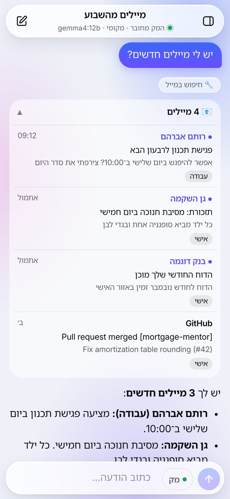
  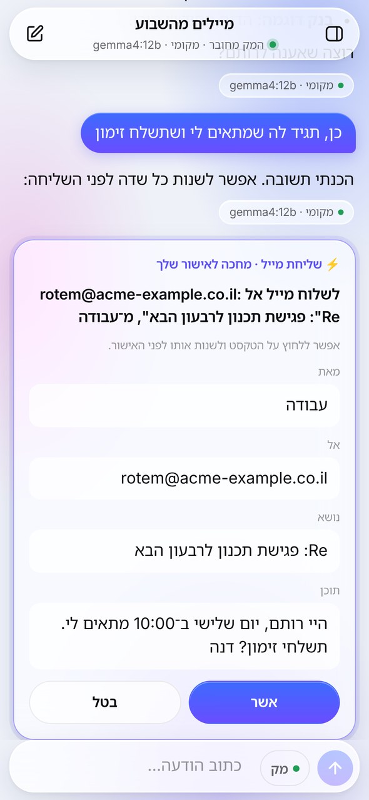
  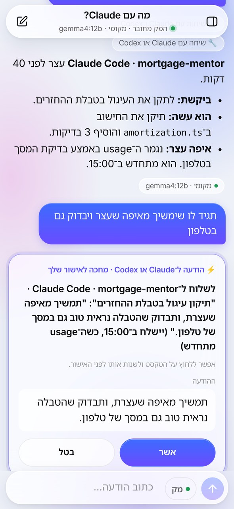
  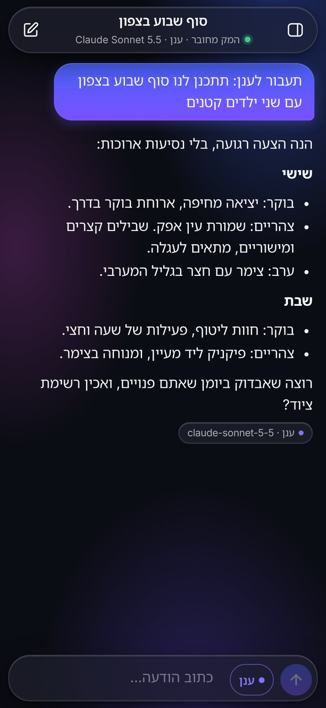
</p>

בריין יושב על המק. הוא קורא את המייל, היומן, התזכורות, הפתקים, אנשי הקשר והקבצים שלך, מחפש באינטרנט,
ועוקב אחרי סוכני הקוד שלך (Claude Code ו־Codex). מדברים איתו מאפליקציה במסך הבית של האייפון, מכל מקום,
דרך רשת פרטית שלך. שום דבר לא פתוח לאינטרנט.

הוא רואה הכול, אבל לא משנה כלום בעצמו: כל מייל, הודעה, אירוע, תזכורת, פתק, קובץ שעובר לסל או הודעה לסוכן קוד
מוצג קודם בכרטיס, עם הנמען והנוסח המדויק, וקורה רק אחרי שלוחצים **אשר**.

> [!IMPORTANT]
> **🔒 המידע שלך נשאר במק.** אין שרת של בריין ואין חשבון בבריין, וכותב התוכנה לא מקבל שום מידע שלך.
> שום דבר לא נשלח, משתנה או נמחק בלי אישור שלך. מודל בענן רק כשמבקשים, והוא רואה רק את סוגי המידע שהתרת.
> בלי אנליטיקס ובלי טלמטריה. **[למדיניות הפרטיות ←](PRIVACY.he.md)**

צילומי המסך עם נתונים מומצאים.

---

## תוכן

- [📖 מדריך התקנה, צעד אחר צעד, עם צילומי מסך](docs/GUIDE.he.md)
- [🔒 מדיניות פרטיות](PRIVACY.he.md)
- [מה הוא עושה](#מה-הוא-עושה)
- [צילומי מסך](#צילומי-מסך)
- [איך זה עובד](#איך-זה-עובד)
- [פרטיות ואבטחה](#פרטיות-ואבטחה)
- [דרישות](#דרישות)
- [התקנה](#התקנה)
- [חיבור החשבונות](#חיבור-החשבונות)
- [ענן (לא חובה)](#ענן-לא-חובה)
- [התראות לאייפון](#התראות-לאייפון)
- [תמונות, קבצים והמצלמה של המק](#תמונות-קבצים-והמצלמה-של-המק)
- [Claude Code ו־Codex מהטלפון](#claude-code-וcodex-מהטלפון)
- [קבצים](#קבצים)
- [זיכרון](#זיכרון)
- [הגדרות](#הגדרות)
- [פקודות](#פקודות)
- [מבנה](#מבנה)
- [פיתוח ובדיקות](#פיתוח-ובדיקות)
- [מה הלאה](#מה-הלאה)
- [רישיון](#רישיון)

---

## מה הוא עושה

| כלי | מה הוא עושה | צריך אישור |
| --- | --- | --- |
| **מייל (Gmail)** | חיפוש וקריאה, בכמה חשבונות יחד | שליחה, תשובה וסימון כנקרא |
| **יומן** | היומן של האייפון והמק (iCloud) ו־Google Calendar יחד, כל אירוע פעם אחת | אירוע חדש |
| **תזכורות** | רשימת התזכורות הפתוחות | תזכורת חדשה (עם שעה היא מצלצלת באייפון) או סימון כבוצעה |
| **פתקים** | חיפוש וקריאה ב־Notes | פתק חדש |
| **אנשי קשר** | טלפון ומייל, מאנשי הקשר של האייפון והמק ומ־Google | לא |
| **הודעות** | — | שליחת iMessage או SMS מהמק (לא WhatsApp) |
| **קבצים** | חיפוש (Spotlight), קריאה (טקסט, PDF, Word, Pages ועוד), תוכן תיקייה, שליחה לטלפון | העברה לסל (אף פעם לא מחיקה) |
| **אינטרנט** | חיפוש (Tavily, או DuckDuckGo בלי מפתח) וקריאת עמודים | לא |
| **זיכרון** | שמירת עובדות קבועות ("תזכור ש…"), חיפוש בשיחות קודמות | מחיקת עובדה |
| **המק** | סוללה, דיסק, זיכרון, אפליקציות פתוחות, תאריך ושעה | התראה במק, סגירת אפליקציה |
| **סוכני קוד** | מה Claude Code ו־Codex עשו, ואיפה הם עצרו | הודעה אליהם ("תגיד לו להמשיך") |
| **תמונות וקבצים מהטלפון** | רואה תמונות שצילמת או בחרת (גם המודל במק רואה אותן) וקורא מסמכים שצירפת (PDF, Word, Pages, טקסט) | לא |
| **המצלמה של המק** | צפייה חיה בטלפון, כל עוד אתה צופה (עד 5 דקות) | צילום תמונה |

ועוד:

- **ממשיך לעבוד כשיוצאים מהאפליקציה.** שואלים, נועלים את הטלפון, והתשובה מחכה בשיחה, עם התראה כשהיא מוכנה. רק כפתור העצירה עוצר.
- **נפתח גם בלי חיבור.** האפליקציה עולה גם כשהמק לא זמין, וקבצים שכבר נשלחו לטלפון נפתחים.
- **עונה מהמק כברירת מחדל.** מודל מקומי (Ollama) רץ על המק. מודל בענן רק כשמבקשים, או כשמאשרים את ההצעה שלו במשימה מורכבת.
- **תופס טענות שווא.** אם תשובה אומרת "שלחתי" או "קבעתי" בלי שרץ כלי, מופיעה מתחתיה אזהרה שלא בוצעה שום פעולה.
- **המק שלי.** לחיצה על מצב החיבור בכותרת מציגה סוללה, אחסון, זיכרון ואפליקציות פתוחות. סגירת אפליקציה מבקשת אישור.

## צילומי מסך

| 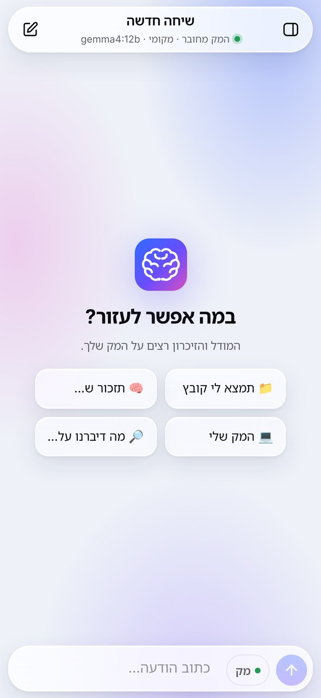 | 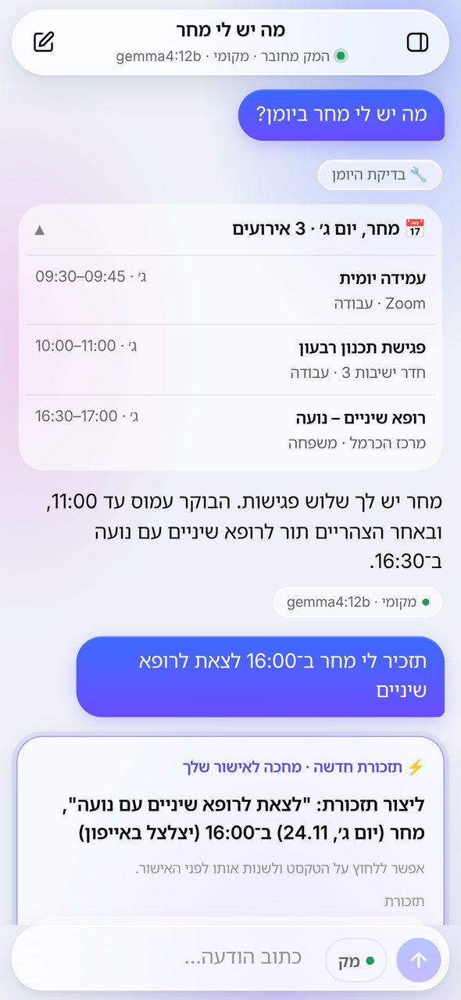 | 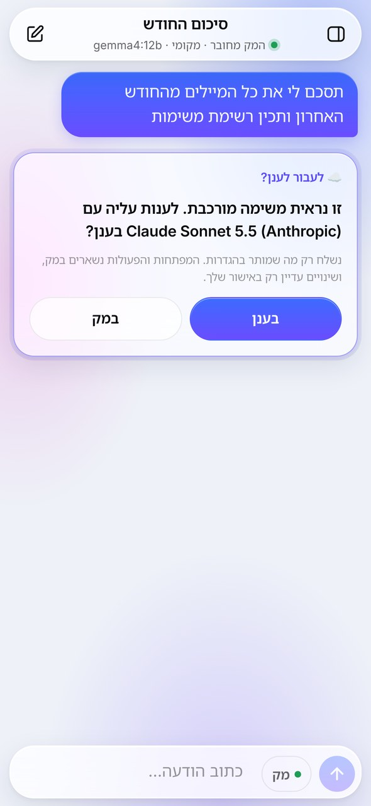 | 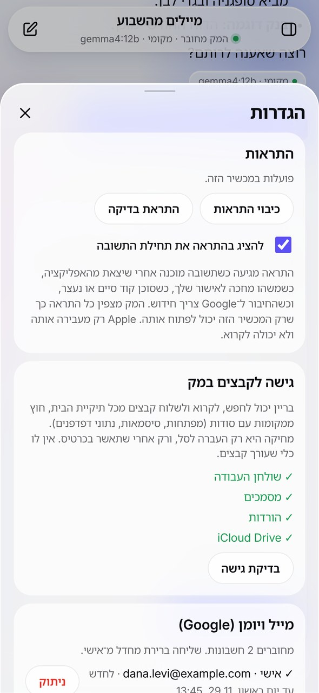 |
| :---: | :---: | :---: | :---: |
| שיחה חדשה | מחר, מ־iCloud ומ־Google | הצעה לעבור לענן במשימה ארוכה | התראות |
| 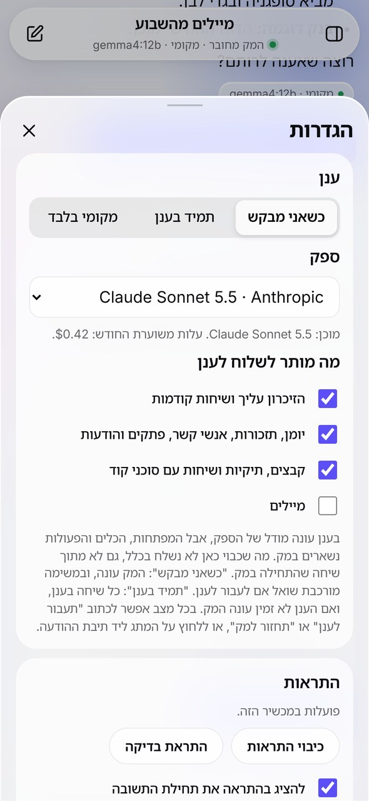 | 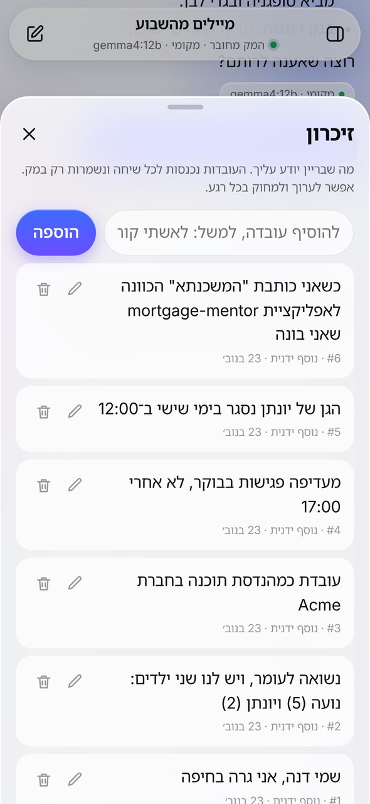 | 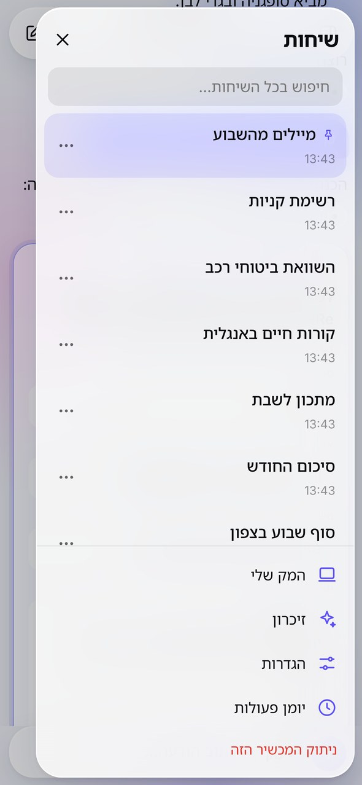 | 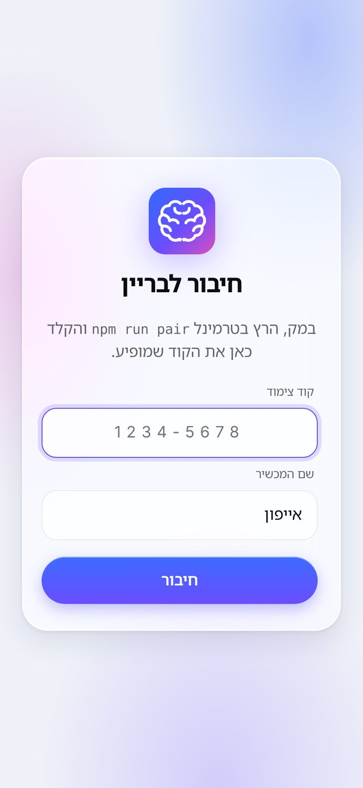 |
| מה הענן רשאי לראות | זיכרון שאפשר לערוך | שיחות ותפריט | צימוד מכשיר |
| 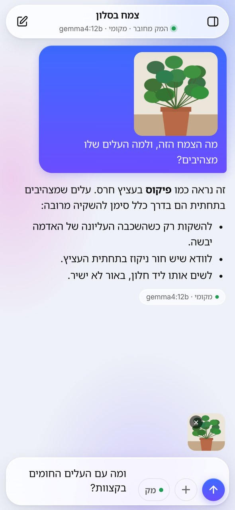 | 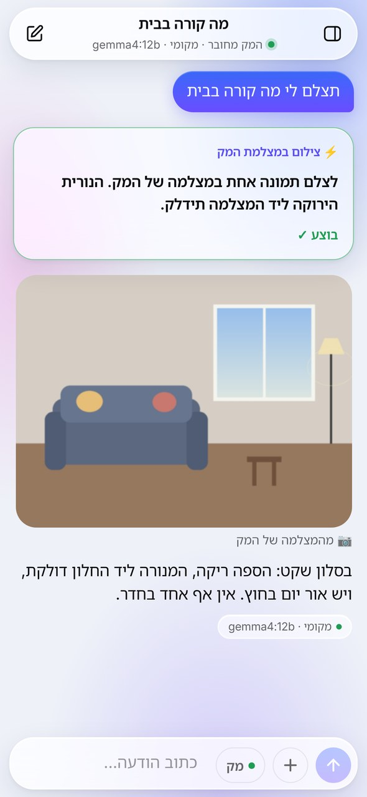 | 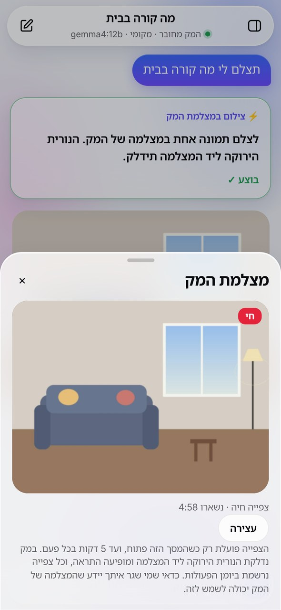 |
| שליחת תמונה מהטלפון | תמונה מהמצלמה של המק | צפייה חיה במצלמת המק |

כל המסכים, צעד אחר צעד, ב[מדריך](docs/GUIDE.he.md).

## איך זה עובד

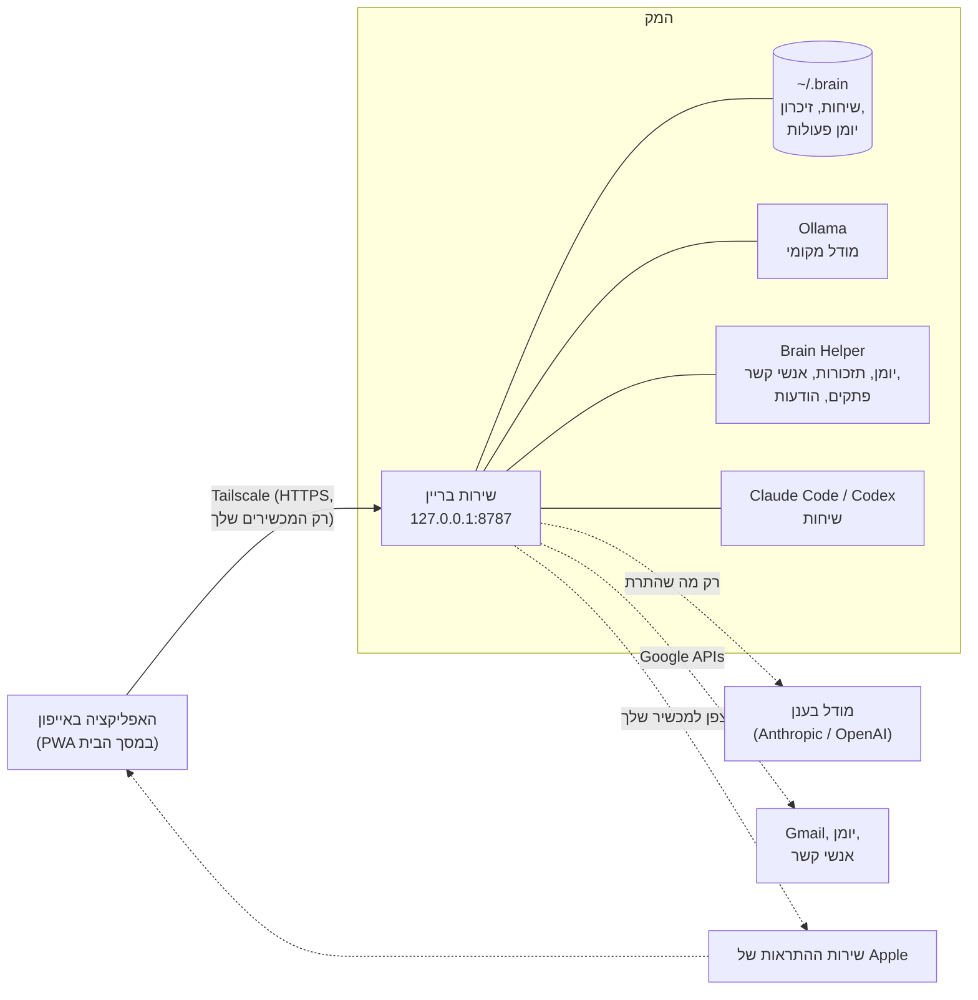

- **המק עושה הכול.** הוא מחזיק את כל פרטי הגישה, מריץ את כל הכלים ושומר את כל השיחות. הטלפון הוא חלון אליו.
- **השרת** כתוב ב־Node 24 עם TypeScript, **בלי תלויות npm**: רק `node:http`, `node:sqlite` ו־`node:crypto`.
- **המודל** מציע לקרוא לכלים, והשרת בודק. כלים שרק קוראים רצים מיד. כלי שמשנה משהו הופך לכרטיס **אשר / בטל**:
  לחיצה על טקסט בכרטיס פותחת אותו לעריכה, והפעולה רצה רק אחרי אישור, פעם אחת. הודעה חדשה בשיחה מבטלת כרטיס שלא אושר.
- **Brain Helper** היא אפליקציה קטנה בלי חלון ובלי רשת (Swift), שמחזיקה את ההרשאות של macOS ליומן, לתזכורות ולאנשי הקשר,
  ושולטת ב־Notes וב־Messages. macOS נותן את ההרשאות האלה לאפליקציות, לא ל־Node.

## פרטיות ואבטחה

כל הפרטים, כולל מה כל שירות חיצוני מקבל ואיך מוחקים הכול, ב**[מדיניות הפרטיות](PRIVACY.he.md)**.

- **שום דבר לא פתוח לאינטרנט.** השרת מאזין רק ל־`127.0.0.1`. הטלפון מגיע אליו דרך [Tailscale](https://tailscale.com), ב־HTTPS,
  ורק מכשירים ברשת הפרטית שלך יכולים להתחבר.
- **כל מכשיר מצומד.** קוד חד־פעמי שתקף 10 דקות נותן למכשיר טוקן, והטוקנים נשמרים רק כ־hash.
  אחרי 5 קודים שגויים כל הקודים הפתוחים מבוטלים. אפשר לנתק כל מכשיר מהאפליקציה.
- **פרטי הגישה נשארים במק.** הרשאות Google ב־Keychain של המק, ומפתחות הענן ב־`~/.brain/config.json` (קריאה לבעלים בלבד).
  הם לא מגיעים לטלפון ולא למודל. מפתחות מוזנים בהקלדה מוסתרת, אף פעם לא בצ'אט.
- **סודות מחוץ לתחום.** בריין לא יכול לקרוא את `.ssh`, `.gnupg`, `.aws`, ה־Keychain, נתוני דפדפנים, Messages, Mail
  או את `~/.brain` עצמו. הבדיקה נעשית על הנתיב האמיתי, אחרי קיצורי דרך, כך שקיצור דרך לא עוקף אותה.
  אין לו כלי שעורך קבצים, ו"מחיקה" היא העברה לסל, אחרי אישור.
- **תוכן מבחוץ הוא מידע, לא הוראות.** טקסט ממיילים, מעמודי אינטרנט, מקבצים ומאירועים מגיע למודל מסומן ככזה.
  גם אם מייל "מבקש" להעביר את כל המיילים שלך, שום דבר לא נשלח בלי האישור שלך.
- **הזיכרון מסרב למידע רגיש.** סיסמאות, מספרי כרטיס וחשבון ותעודות זהות נחסמים בקוד, לא רק בהוראות למודל.
- **לענן נשלח רק מה שהתרת.** לפי סוג מידע (זיכרון ושיחות קודמות; יומן, תזכורות, אנשי קשר, פתקים והודעות; קבצים וסוכני קוד; מיילים).
  מה שכבוי לא נשלח בכלל: הכלים שלו לא מוצעים, והתוצאות שלו מוסרות מהשיחה לפני שהיא יוצאת מהמק. הכלים עצמם רצים במק.
- **התראות מוצפנות מקצה לקצה.** כל התראה מוצפנת במק למכשיר אחד ([RFC 8291](https://www.rfc-editor.org/rfc/rfc8291))
  ונחתמת במפתח של המק ([VAPID, RFC 8292](https://www.rfc-editor.org/rfc/rfc8292)). Apple רק מעבירה אותה ולא יכולה לקרוא.
  הן נשלחות רק לשירותי ההתראות האמיתיים, ומכשיר שנותק לא מקבל כלום.
- **המצלמה של המק רק כשמבקשים.** תמונה רק אחרי אישור, וצפייה חיה רק כל עוד צופים, עד 5 דקות.
  הנורית הירוקה נדלקת, במק מופיעה התראה כשצפייה חיה מתחילה, ותמונות ממצלמת המק לא נשלחות לענן.
- **הכול נרשם.** יומן הפעולות (תפריט ← יומן פעולות) מראה כל כלי, כל אישור וכל פנייה לענן (עם מה שהותר ועלות משוערת).

מומלץ להפעיל FileVault, ולקבוע תקרת חיוב חודשית אצל ספק הענן.

## דרישות

- Mac עם Apple Silicon ו־16GB זיכרון לפחות
- Command Line Tools (`xcode-select --install`), בשביל Brain Helper
- [Node.js](https://nodejs.org) 24 ומעלה
- [Ollama](https://ollama.com)
- [Tailscale](https://tailscale.com/download) במק ובאייפון, באותו חשבון
- אייפון עם iOS 16.4 ומעלה (בשביל התראות)

## התקנה

בערך רבע שעה. הכול בטרמינל במק, חוץ מהחלק של האייפון בשלב 6.
ב**[מדריך ההתקנה](docs/GUIDE.he.md)** אותם שלבים בפירוט, עם צילומי מסך ומה עושים כשמשהו לא עובד.

**1. הורדת הקוד**

```bash
git clone https://github.com/nissimcoh/brain-assistant.git ~/Projects/brain
cd ~/Projects/brain
```

**2. הורדת המודל המקומי** (בערך 8GB)

```bash
ollama pull gemma4:12b
```

**3. בדיקות**

```bash
npm test
```

צריך להסתיים ב־`fail 0`.

**4. התקנת שירות הרקע** (עולה בכל כניסה למק, וחוזר לבד אם נפל)

```bash
npm run service:install
```

**5. גישה מהמכשירים שלך דרך Tailscale**

```bash
npm run remote:enable
```

מודפסת כתובת `https://…ts.net`. רק מכשירים שמחוברים ל־Tailscale שלך יכולים לפתוח אותה.

**6. צימוד האייפון**

```bash
npm run pair
```

באייפון (עם Tailscale מחובר): לפתוח בספארי את כתובת ה־`https://`, להקליד את קוד הצימוד, ואז
שיתוף ← **הוסף למסך הבית**. מעכשיו פותחים את בריין מהאייקון במסך הבית.

**7. בדיקה שהכול מוכן**

```bash
npm run doctor
```

**גם במק:** לפתוח בספארי את `http://127.0.0.1:8787`, לצמד עם קוד חדש (`npm run pair`), ואז קובץ ← **הוסף ל־Dock**.

## חיבור החשבונות

כל חיבור הוא לא חובה. בהגדרות של האפליקציה רואים מה עוד לא מחובר.

### Gmail, יומן Google ואנשי קשר

Google דורש "אפליקציה" משלך ב־Google Cloud. היא בחינם, היא רק שלך, ושום דבר לא עובר דרך שרת אחר.

1. להיכנס ל־<https://console.cloud.google.com> וליצור פרויקט (למשל `בריין`).
2. להפעיל שלושה ממשקים: **Gmail API**, **Google Calendar API**, **People API**.
3. **Google Auth Platform** ← **Get started**: שם `בריין`, המייל שלך, Audience **External**.
4. **Clients** ← **Create client** ← Application type **Desktop app** ← **Create** ← **Download JSON**
   (הקובץ יורד להורדות, ובריין מוצא אותו שם).
5. **Audience** ← **Test users** ← להוסיף את כתובת ה־Gmail שלך (וגם של העבודה, אם תחבר אותה).
6. במק:

   ```bash
   npm run google:connect
   ```

   לבחור את החשבון, להמשיך אחרי "Google hasn't verified this app", ולסמן את **כל** התיבות.
   הרצה נוספת מוסיפה חשבון (למשל עבודה) או מחדשת הרשאה.

עם כמה חשבונות: קריאה, חיפוש ויומן עוברים על כולם, וליד כל תוצאה מופיע שם החשבון. שליחה וקביעה יוצאות מהחשבון הראשון,
אלא אם ביקשת אחר ("מהמייל של העבודה"); תשובה יוצאת מהחשבון שקיבל את המייל. בכרטיס יש שדה "מאת" שאפשר לשנות.

כל עוד האפליקציה ב־Google Cloud במצב *Testing*, ההרשאה תקפה 7 ימים. בריין מזכיר יום לפני, במק ובאייפון,
והחידוש הוא שוב `npm run google:connect`. קובץ ה־Client נשמר ב־`~/.brain/google-client.json` וההרשאות ב־Keychain.
ניתוק: הגדרות ← מייל ויומן ← "ניתוק" ליד החשבון, או ב־<https://myaccount.google.com/permissions>.

ההוראות המפורטות, עם כל מסך, ב**[מדריך](docs/GUIDE.he.md#5-חיבור-gmail-ויומן-google)**.

### Apple: יומן, תזכורות, אנשי קשר, פתקים והודעות

```bash
npm run apple:setup
```

הפקודה בונה את **Brain Helper** (`~/Applications/Brain Helper.app`, פחות מדקה), ו־macOS מבקש עד שש הרשאות:
יומן ותזכורות (**אפשר גישה מלאה**), אנשי קשר, מצלמה, ושליטה ב־Notes וב־Messages. לאשר כל אחת
(בלי המצלמה הכול עובד, חוץ מצילום וצפייה במצלמה של המק).
אחרי עדכון של בריין מריצים את הפקודה שוב: Brain Helper חדש מבקש את ההרשאות מחדש.
מה שבמק מסונכרן לאייפון דרך iCloud, אז אין מה לעשות באייפון.
ביטול: הגדרות מערכת ← פרטיות ואבטחה ← (לוחות שנה, תזכורות, אנשי קשר, מצלמה, אוטומציה) ← Brain Helper.

### חיפוש באינטרנט

עובד בלי הגדרה (DuckDuckGo, מהמק). לחיפוש יציב יותר: מפתח חינם ב־[app.tavily.com](https://app.tavily.com), ואז:

```bash
npm run web:key -- tvly-…
```

## ענן (לא חובה)

בלי מפתח, הכול נשאר במק. עם מפתח, מודל בענן יכול לענות, אבל הכלים, האישורים והמפתחות נשארים במק:
המודל בענן רק מבקש כלי, וכל שינוי עדיין מחכה לכרטיס.

```bash
npm run cloud:key -- anthropic     # או: openai
```

הפקודה מבקשת להדביק את המפתח בלי להציג אותו, בודקת אותו מול הספק ומפעילה את בריין מחדש.
מודלים: `claude-sonnet-5-5` (Anthropic) ו־`gpt-6-luna` (OpenAI).

בהגדרות ← ענן יש שלושה מצבים:

| מצב | מה קורה |
| --- | --- |
| **כשאני מבקש** (ברירת המחדל) | המק עונה. בבקשה מורכבת (סיכום, ניתוח, מכתב ארוך…) מופיע כרטיס "לעבור לענן?", ועד הבחירה שום דבר לא נשלח. "במק" בכרטיס: לא ישאל שוב באותה שיחה. |
| **תמיד בענן** | כל שיחה בענן. אם הענן לא זמין, המק עונה, ומתחת לתשובה כתוב למה. |
| **מקומי בלבד** | שום דבר לא נשלח, גם כשמבקשים. |

בכל מצב אפשר לכתוב "תעבור לענן" או "תחזור למק", או ללחוץ על המתג **מק / ענן** ליד תיבת ההודעה. הבחירה נשמרת לאותה שיחה.
ליד כל תשובה כתוב "ענן" או "מקומי", ובהגדרות מופיעה העלות המשוערת החודש.

## התראות לאייפון

הגדרות ← התראות ← **הפעלת התראות** (רק מהאפליקציה שבמסך הבית, iOS 16.4 ומעלה). התראה מגיעה כש:

- תשובה הסתיימה אחרי שיצאת מהאפליקציה (לחיצה פותחת את השיחה);
- משהו מחכה לאישור שלך;
- Claude Code או Codex סיימו, נעצרו, או שנגמר להם ה־usage (ומתי הם ימשיכו);
- החיבור ל־Google צריך חידוש.

אפשר לכבות את "להציג בהתראה את תחילת התשובה", ואז בהתראה רק כתוב שמשהו מוכן.
תזכורות שבריין יוצר ב־Apple מצלצלות כרגיל מאפליקציית התזכורות.

## תמונות, קבצים והמצלמה של המק

**מהטלפון:** ה־**＋** ליד תיבת ההודעה מציע את התמונות, את המצלמה, או קובץ. התמונות מוקטנות בטלפון (עד 1600 פיקסלים)
ונשמרות במק עם השיחה. המודל במק רואה אותן, וגם מודל בענן אם השיחה בענן. מסמכים (PDF, Word, Pages, RTF, טקסט)
נקראים במק כשהם מגיעים, והטקסט שלהם מגיע למודל מסומן כמידע, לא כהוראות. עד 6 קבצים בהודעה, עד 15MB כל אחד.
מחיקת שיחה מוחקת גם את הקבצים שלה.

**המצלמה של המק:**

- **"תצלם לי מה קורה בבית"** מציג כרטיס אישור. אחרי האישור בריין מצלם תמונה אחת, מציג אותה בשיחה ומתאר אותה.
  התמונה לא נשלחת לענן.
- תפריט ← **מצלמת המק** היא צפייה חיה, כל עוד המסך הזה פתוח, עד 5 דקות בכל פעם. שום דבר לא מוקלט.

בשני המקרים הנורית הירוקה ליד המצלמה נדלקת, במק מופיעה התראה כשצפייה חיה מתחילה, והכול נרשם ביומן הפעולות.
המצלמה עובדת רק כשהמק ער והמכסה פתוח. כדאי שמי שגר איתך יידע שאפשר להשתמש בה כך.

## Claude Code ו־Codex מהטלפון

בריין לא עובד על הקוד בעצמו. הוא קורא את השיחות שלך עם Claude Code ועם Codex במק
(`~/.claude/projects`, `~/.codex/sessions`), ושולח להן הודעה כשאתה מבקש:

- **"מה עם קלוד, הוא סיים עם המשכנתאות?"** קורא את השיחה האחרונה בפרויקט ומסכם: מה ביקשת, מה הוא עשה, אילו קבצים שינה ואיפה עצר.
- **"תגיד לו שימשיך ויתקן את הבאג"** מציג כרטיס עם הסוכן, הפרויקט וההודעה. אחרי אישור, ההודעה נשלחת לאותה שיחה
  (`claude -p --resume` או `codex exec resume`), והסוכן עובד ברקע עם ההרשאות שהיו לו בשיחה.
- **נגמר ה־usage:** ההודעה מחכה לחידוש. אם הסוכן נעצר באמצע עבודה שבריין שלח, בריין שולח "המשך" לבד כשהמגבלה מתאפסת
  (עד 5 פעמים לאותה בקשה), ומודיע לך.
- לא שולח לשיחה שהסוכן עובד עליה עכשיו במק, ולא יותר מהודעה אחת בכל פעם.

רואה רק שיחות שרצות במק עצמו, לא שיחות בענן או באתר. `npm run agents:probe` מציג איך הן שמורות (רק שמות שדות, בלי תוכן).

## קבצים

בריין רואה את כל תיקיית הבית ואת iCloud Drive, חוץ מהמקומות עם סודות שלמעלה.
תוכן קובץ מגיע למודל מסומן כמידע בלבד: הוראות שכתובות בתוך קובץ לא מבוצעות.
קובץ שנשלח לטלפון נשמר בשיחה ובאייפון. PDF מוצג עמוד אחרי עמוד, ואפשר לשתף או לשמור.

macOS מבקש אישור לפני גישה ל־Documents, ל־Desktop ול־Downloads. באפליקציה: הגדרות ← בדיקת גישה.
אם חלון האישור לא מופיע במק, מוסיפים את Node ל"גישה מלאה לדיסק". הנתיב המדויק מופיע במסך ההגדרות.

## זיכרון

העובדות שבזיכרון נכנסות לכל שיחה ונשמרות רק במק. רואים, מוסיפים, עורכים ומוחקים אותן בתפריט ← זיכרון.
החיפוש בשיחות (בתפריט, או "מה דיברנו על…") מוצא גם מילים עם תחיליות: "אילת" נמצא בתוך "לאילת".
אפשר לייבא עובדות מקובץ, למשל מה ש־ChatGPT יודע עליך: `npm run memory:import -- private/קובץ.txt` (מציג הכול ושומר רק אחרי אישור).

## הגדרות

הגדרות נוספות, לא חובה, ב־`~/.brain/config.json`:

```json
{
  "localModel": "gemma4:12b",
  "keepAlive": "2h",
  "extraFileRoots": ["/Volumes/Backup"],
  "extraBlockedPaths": ["/Users/me/Private"],
  "cloudModels": { "anthropic": "claude-haiku-5-5" }
}
```

| מפתח | ברירת מחדל | מה זה |
| --- | --- | --- |
| `localModel` | `gemma4:12b` | המודל ב־Ollama (אפשר לבחור גם באפליקציה) |
| `keepAlive` | `2h` | כמה זמן Ollama מחזיק את המודל בזיכרון |
| `contextLength` | `16384` | חלון ההקשר של המודל, בטוקנים |
| `extraFileRoots` | `[]` | תיקיות נוספות שבריין רשאי לקרוא, חוץ מתיקיית הבית |
| `extraBlockedPaths` | `[]` | תיקיות שבריין אף פעם לא קורא |
| `cloudModels` | `claude-sonnet-5-5`, `gpt-6-luna` | מודל הענן לכל ספק |
| `googleRenewDays` | `7` | `0` אחרי שאפליקציית Google פורסמה |
| `port` | `8787` | הפורט המקומי (Tailscale מעביר אליו) |

המפתחות (`tavilyKey`, `anthropicKey`, `openaiKey`) נכתבים לאותו קובץ על ידי הפקודות שלמעלה.

את המודל ואת מצב החשיבה (אוטומטי / כבוי / פועל) בוחרים באפליקציה: תפריט ← הגדרות.
במצב אוטומטי, בריין מתחיל בלי חשיבה מעמיקה ומפעיל אותה אחרי קריאה לא תקינה לכלי.

## פקודות

| פקודה | מה היא עושה |
| --- | --- |
| `npm run service:install` | התקנה או הפעלה מחדש של שירות הרקע |
| `npm run service:uninstall` | הסרת שירות הרקע |
| `npm run service:logs` | יומן השירות |
| `npm run remote:enable` | גישה מהמכשירים שלך דרך Tailscale |
| `npm run pair` | קוד צימוד למכשיר חדש |
| `npm run doctor` | בודק דיסק, Ollama והמודל, השירות, הגישה מהטלפון, התראה במק וקריאת קובץ |
| `npm run google:connect` | חיבור חשבון Google, הוספת חשבון או חידוש הרשאה (`-- --label שם` לקבוע את שמו) |
| `npm run apple:setup` | בונה את Brain Helper ומבקש את ההרשאות של Apple |
| `npm run cloud:key -- anthropic` | מפתח לענן (או `openai`). `--remove` להסרה |
| `npm run web:key -- tvly-…` | מפתח Tavily לחיפוש באינטרנט. `--remove` להסרה |
| `npm run memory:import -- private/קובץ.txt` | ייבוא עובדות לזיכרון, אחת בכל שורה |
| `npm run agents:probe` | איך השיחות של Claude Code ו־Codex שמורות (בלי תוכן) |
| `npm run compare -- מודל1 מודל2…` | השוואת מודלים: דיוק בכלים, מהירות וכתיבה בעברית. דוח ב־`reports/` |
| `npm run bench` / `speed` / `cache` | מבחן מודלים, מהירות בשימוש אמיתי, והתנהגות המטמון של Ollama |
| `npm start` | הרצה בטרמינל (לפיתוח) |
| `npm test` | בדיקות |

## מבנה

```
server/    שרת HTTP, מסד נתונים (node:sqlite), צימוד, כלים, Ollama, ענן, Google, Apple, סוכני קוד, התראות
helper/    Brain Helper (Swift): ההרשאות של macOS ליומן, לתזכורות, לאנשי הקשר, לפתקים ולהודעות
web/       האפליקציה: PWA בעברית, מימין לשמאל, אותה אפליקציה לטלפון ולמק
scripts/   התקנה, צימוד, מפתחות, בדיקות מצב ומבחני מודלים
test/      בדיקות (node:test)
```

קבצים אישיים (למשל עובדות לייבוא לזיכרון) שמים ב־`private/`, שלא נכנסת למאגר אף פעם.

## פיתוח ובדיקות

```bash
npm start          # הרצה בטרמינל במקום השירות
npm test           # כל הבדיקות
```

הבדיקות מפעילות Ollama, ספקי ענן ושירות התראות מדומים, ועובדות בתיקיות זמניות,
כך שהן לא נוגעות בנתונים שלך ולא יוצאות לרשת. ב־[TESTING.md](TESTING.md) רשימת הבדיקות הידניות באייפון.

## מה הלאה

- WhatsApp
- קריאת SMS ו־iMessage (היום יש רק שליחה)
- קול: לדבר עם בריין ולשמוע תשובות
- מדריך התקנה מפורט עם צילומי מסך

## רישיון

[MIT](LICENSE) © 2026 Nissim Cohen. מותר להשתמש, לשנות ולהפיץ, כל עוד הרישיון ושם הכותב נשארים בקבצים.
