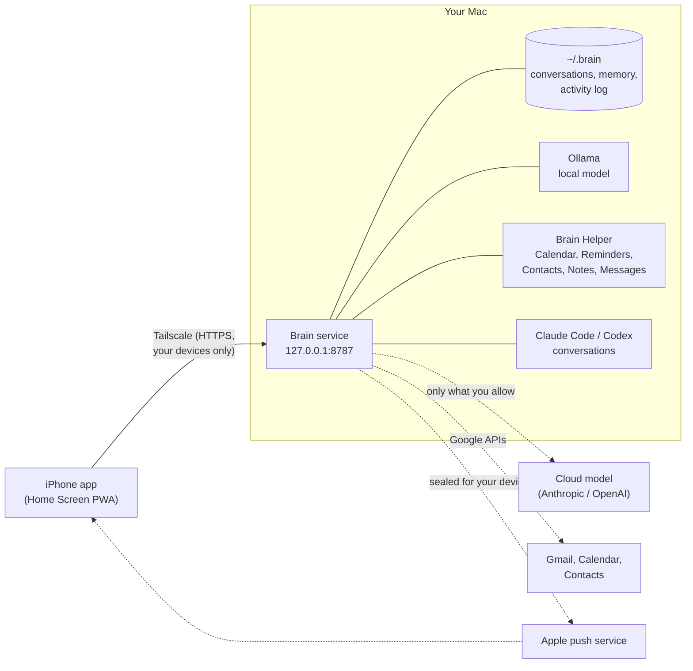

# Brain · בריין

**A private, Hebrew-speaking personal assistant that runs on your Mac and that you talk to from your iPhone.**

[עברית](README.he.md)

Brain lives on your Mac. It reads your mail, calendar, reminders, notes, contacts and files, searches the web,
and keeps an eye on your coding agents (Claude Code and Codex). You talk to it from an app on your iPhone's Home Screen,
from anywhere, over your own private network. Nothing is opened to the internet.

It sees everything, but it never changes anything on its own: every email, message, event, reminder, note,
deleted file or message to a coding agent is shown to you first on a card, with the recipient and the exact text,
and happens only after you tap **Approve**.

> Brain speaks Hebrew: the app, its answers and the setup scripts are in Hebrew. This README is the English guide.

---

## Contents

- [What it does](#what-it-does)
- [How it works](#how-it-works)
- [Privacy and security](#privacy-and-security)
- [Requirements](#requirements)
- [Installation](#installation)
- [Connecting your accounts](#connecting-your-accounts)
- [The cloud (optional)](#the-cloud-optional)
- [Notifications](#notifications)
- [Claude Code and Codex from your phone](#claude-code-and-codex-from-your-phone)
- [Configuration](#configuration)
- [Commands](#commands)
- [Project structure](#project-structure)
- [Development](#development)
- [Roadmap](#roadmap)
- [License](#license)

---

## What it does

| Area | Brain can… | Needs your approval |
| --- | --- | --- |
| **Mail (Gmail)** | Search and read mail across several accounts, find contacts | Sending, replying, marking as read |
| **Calendar** | Read the iPhone/Mac calendar (iCloud) and Google Calendar together | Creating an event |
| **Reminders** | List open reminders | Creating one (it rings on the iPhone) or completing one |
| **Notes** | Search and read Apple Notes | Creating a note |
| **Messages** | Find a contact's phone number | Sending an iMessage or SMS from the Mac |
| **Files** | Search (Spotlight), read (text, PDF, Word, Pages…), list folders, send a file to the phone | Moving to the Trash (never deleting) |
| **Web** | Search (Tavily, or DuckDuckGo without a key) and read pages | — |
| **Memory** | Remember lasting facts about you, search past conversations | Forgetting a fact |
| **Your Mac** | Battery, disk, memory, open apps | Showing a notification, quitting an app |
| **Coding agents** | Summarize what Claude Code / Codex did and where they stopped | Sending them a message ("tell it to continue") |

It also:

- **Keeps working when you leave the app.** Ask something, lock the phone, and the answer waits in the conversation,
  with a notification when it is ready.
- **Opens without a connection.** The app starts even when the Mac is unreachable, and files it already received stay viewable.
- **Answers locally by default.** A local model (Ollama) runs on the Mac. A cloud model is used only when you ask for it,
  or when you accept its offer for a complex task.
- **Catches false claims.** If an answer says "sent" or "scheduled" but no action ran, a warning appears under it.

## How it works



- **The Mac does everything.** It holds every credential, runs every tool and stores every conversation.
  The phone is a window onto it.
- **The server** is Node 24 with TypeScript and **no npm dependencies**: `node:http`, `node:sqlite` and `node:crypto` only.
- **The model** proposes tool calls; the server checks them. Tools that only read run at once. Tools that change something
  become a card that you can edit before approving, and they run once, only after you approve.
- **Brain Helper** is a tiny windowless Mac app (Swift, no network access) that holds macOS's permissions for Calendar,
  Reminders and Contacts and drives Notes and Messages. macOS grants these permissions to apps, not to Node.

## Privacy and security

- **Nothing is exposed to the internet.** The server listens on `127.0.0.1` only. Your phone reaches it through
  [Tailscale](https://tailscale.com), over HTTPS, and only devices on your own tailnet can connect.
- **Every device is paired.** A one-time code valid for 10 minutes gives a device its token; tokens are stored only as hashes.
  Five wrong codes cancel all open codes. You can disconnect any device from the app.
- **Credentials stay on the Mac.** Google permissions are in the macOS Keychain; cloud keys are in `~/.brain/config.json`
  (readable by you only). None of them ever reaches the phone or the model. Keys are entered with hidden input, never in chat.
- **Secrets are off limits.** Brain cannot read `.ssh`, `.gnupg`, `.aws`, the Keychain, browser data, Messages, Mail
  or its own `~/.brain`. Paths are checked after resolving symlinks, so a shortcut can't get around it.
  It has no tool that edits files; "delete" means moving to the Trash, after approval.
- **Outside content is data, not instructions.** Text from mails, web pages, files and events reaches the model marked as such.
  If an email "asks" Brain to forward your mail, nothing is sent without your approval.
- **Memory refuses sensitive data.** Passwords, card and account numbers and ID numbers are blocked in code,
  not only by instructions to the model.
- **The cloud gets only what you allow.** Per category (memory and past conversations; calendar, reminders, contacts, notes
  and messages; files and coding agents; mail). A category that's off is never sent: its tools aren't offered
  and its results are removed from the conversation before it leaves the Mac. The tools still run on the Mac.
- **Notifications are end-to-end encrypted.** Each one is encrypted on the Mac for one device ([RFC 8291](https://www.rfc-editor.org/rfc/rfc8291))
  and signed with the Mac's own key ([VAPID, RFC 8292](https://www.rfc-editor.org/rfc/rfc8292)). Apple only carries it.
  They go only to the real push services, and a disconnected device gets nothing.
- **Everything is logged.** The activity log (menu → Activity) shows every tool, approval and cloud request
  (with what was allowed and an estimated cost).

Recommended: turn on FileVault, and set a monthly spending limit with your cloud provider.

## Requirements

- A Mac with Apple Silicon and at least 16 GB of memory
- The Command Line Tools (`xcode-select --install`), for Brain Helper
- [Node.js](https://nodejs.org) 24 or later
- [Ollama](https://ollama.com)
- [Tailscale](https://tailscale.com/download) on the Mac and on the iPhone, signed in to the same account
- An iPhone with iOS 16.4 or later (for notifications)

## Installation

About 15 minutes. Everything runs in Terminal on the Mac, except the iPhone part of step 6.

**1. Get the code**

```bash
git clone https://github.com/nissimcoh/brain-assistant.git ~/Projects/brain
cd ~/Projects/brain
```

**2. Download the local model** (about 8 GB)

```bash
ollama pull gemma4:12b
```

**3. Run the tests**

```bash
npm test
```

It should end with `fail 0`.

**4. Install the background service** (starts at login, restarts if it crashes)

```bash
npm run service:install
```

**5. Open it to your devices through Tailscale**

```bash
npm run remote:enable
```

It prints an `https://…ts.net` address. Only devices signed in to your Tailscale can open it.

**6. Pair your iPhone**

```bash
npm run pair
```

On the iPhone (with Tailscale on): open the `https://` address in Safari, type the pairing code, then
Share → **Add to Home Screen**. From now on, open Brain from the Home Screen icon.

**7. Check everything**

```bash
npm run doctor
```

**On the Mac too:** open `http://127.0.0.1:8787` in Safari, pair with a new code (`npm run pair`), then File → **Add to Dock**.

## Connecting your accounts

Each one is optional. The app's Settings show what isn't connected yet.

### Gmail, Google Calendar and Contacts

Google requires your own (free) app in Google Cloud. It belongs to you only, and nothing goes through any other server.

1. Go to <https://console.cloud.google.com> and create a project (for example `Brain`).
2. Enable three APIs: **Gmail API**, **Google Calendar API**, **People API**.
3. Open **Google Auth Platform** → **Get started**: app name `Brain`, your email, Audience **External**.
4. **Clients** → **Create client** → Application type **Desktop app** → **Create** → **Download JSON**
   (it lands in Downloads; Brain finds it there).
5. **Audience** → **Test users** → add your Gmail address (and your work address, if you'll connect it).
6. On the Mac:

   ```bash
   npm run google:connect
   ```

   Choose the account, continue past "Google hasn't verified this app", and tick **all** the boxes.
   Run it again to add another account (for example work), or to renew a permission.

While the Google app is in *Testing*, Google cancels the permission after 7 days. Brain reminds you a day before,
on the Mac and on the phone; renewing is `npm run google:connect` again. The client file is kept in `~/.brain/google-client.json`
and the permissions in the Keychain. You can disconnect from the app's Settings or at <https://myaccount.google.com/permissions>.

### Apple: Calendar, Reminders, Contacts, Notes and Messages

```bash
npm run apple:setup
```

It builds **Brain Helper** (`~/Applications/Brain Helper.app`, under a minute) and macOS asks for up to five permissions:
Calendar and Reminders (**Allow Full Access**), Contacts, and control of Notes and Messages. Approve each one.
Whatever is on the Mac syncs with the iPhone through iCloud, so there is nothing to do on the phone.
To revoke: System Settings → Privacy & Security → (Calendars, Reminders, Contacts, Automation) → Brain Helper.

### Web search

It works without setup (DuckDuckGo, from the Mac). For steadier results, get a free key at
[app.tavily.com](https://app.tavily.com) and run:

```bash
npm run web:key -- tvly-…
```

## The cloud (optional)

Without a key, everything stays on the Mac. With one, a cloud model can answer, but the tools, the approvals
and the keys stay on the Mac: the cloud model can only ask for a tool, and anything that changes something still waits for your card.

```bash
npm run cloud:key -- anthropic     # or: openai
```

The command asks you to paste the key without showing it, checks it with the provider and restarts Brain.
Default models: `claude-sonnet-5-5` (Anthropic) and `gpt-6-luna` (OpenAI).

Settings → Cloud has three modes:

| Mode | What happens |
| --- | --- |
| **When I ask** (default) | The Mac answers. A complex request (a summary, an analysis, a long letter…) shows a "Move to the cloud?" card, and nothing is sent until you choose. |
| **Always in the cloud** | Every conversation is answered in the cloud; if the cloud is unavailable, the Mac answers and says why. |
| **Local only** | Nothing is ever sent. |

In any mode you can write "תעבור לענן" (move to the cloud) or "תחזור למק" (back to the Mac), or tap the **Mac / Cloud** switch
next to the message box. The choice sticks to that conversation. Each answer is labeled "cloud" or "local",
and Settings shows this month's estimated spend.

## Notifications

Settings → Notifications → **Turn on notifications** (from the Home Screen app; iOS 16.4 or later). You'll get a notification when:

- an answer finishes after you left the app (tapping it opens the conversation);
- something is waiting for your approval;
- Claude Code or Codex finished, stopped, or ran out of usage (and when they'll continue);
- the Google connection needs renewing.

You can turn off "Show the start of the reply"; notifications then only say that something is ready.
Reminders that Brain creates in Apple Reminders ring through the Reminders app as usual.

## Claude Code and Codex from your phone

Brain never works on your code itself. It reads your Claude Code and Codex conversations on the Mac
(`~/.claude/projects`, `~/.codex/sessions`) and relays messages to them when you ask:

- *"What about Claude, did it finish the mortgage app?"* reads the latest conversation in that project and summarizes
  what you asked, what it did, which files it changed and where it stopped.
- *"Tell it to continue and fix the bug"* shows a card with the agent, the project and the message. After you approve,
  the message goes into the same conversation (`claude -p --resume` / `codex exec resume`), and the agent works
  in the background with the permissions it already had there.
- **Usage limits:** a message waits for the reset. If an agent stops in the middle of work Brain sent it, Brain sends
  "continue" by itself when the limit resets (up to five times per request), and notifies you.
- It never sends to a conversation that is active on the Mac right now, and only one message at a time.

Only conversations on the Mac itself are visible, not ones in the cloud or on the web.
`npm run agents:probe` shows how they're stored (field names only, no content).

## Configuration

Optional settings go in `~/.brain/config.json`:

```json
{
  "localModel": "gemma4:12b",
  "keepAlive": "2h",
  "extraFileRoots": ["/Volumes/Backup"],
  "extraBlockedPaths": ["/Users/me/Private"],
  "cloudModels": { "anthropic": "claude-haiku-5-5" }
}
```

| Key | Default | Meaning |
| --- | --- | --- |
| `localModel` | `gemma4:12b` | The Ollama model (also selectable in the app) |
| `keepAlive` | `2h` | How long Ollama keeps the model in memory |
| `contextLength` | `16384` | The model's context window, in tokens |
| `extraFileRoots` | `[]` | Folders Brain may read besides your home folder |
| `extraBlockedPaths` | `[]` | Folders Brain must never read |
| `cloudModels` | `claude-sonnet-5-5`, `gpt-6-luna` | The cloud model per provider |
| `googleRenewDays` | `7` | Set to `0` once your Google app is published |
| `port` | `8787` | The local port (Tailscale forwards to it) |

The keys (`tavilyKey`, `anthropicKey`, `openaiKey`) are written to the same file by the commands above.

## Commands

| Command | What it does |
| --- | --- |
| `npm run service:install` | Install or restart the background service |
| `npm run service:uninstall` | Remove the background service |
| `npm run service:logs` | Follow the service log |
| `npm run remote:enable` | Reach Brain from your devices through Tailscale |
| `npm run pair` | A pairing code for a new device |
| `npm run doctor` | Check disk, Ollama, the model, the service, remote access, a Mac notification and file access |
| `npm run google:connect` | Connect a Google account, add another, or renew a permission (`-- --label name` to name it) |
| `npm run apple:setup` | Build Brain Helper and ask for the Apple permissions |
| `npm run cloud:key -- anthropic` | Add a cloud key (or `openai`); `--remove` to remove it |
| `npm run web:key -- tvly-…` | Add a Tavily key for web search; `--remove` to remove it |
| `npm run memory:import -- private/facts.txt` | Import facts into memory, one per line; shows them all and saves only after you confirm |
| `npm run agents:probe` | Show how Claude Code and Codex conversations are stored (no content) |
| `npm run compare -- model1 model2…` | Compare models on tool accuracy, speed and Hebrew writing; report in `reports/` |
| `npm run bench` / `speed` / `cache` | Model benchmark, real-use speed test, and prompt-cache behavior |
| `npm start` | Run in the terminal (development) |
| `npm test` | Run the tests |

## Project structure

```
server/    HTTP server, database (node:sqlite), pairing, tools, Ollama, cloud, Google, Apple, agents, notifications
helper/    Brain Helper (Swift): macOS permissions for Calendar, Reminders, Contacts, Notes and Messages
web/       The app: a right-to-left Hebrew PWA, the same one on the phone and on the Mac
scripts/   Setup, pairing, keys, diagnostics and benchmarks
test/      Tests (node:test)
```

Personal files (for example facts to import into memory) belong in `private/`, which is never committed.

## Development

```bash
npm start          # run in the terminal instead of the service
npm test           # all tests
```

The tests start their own fake Ollama, cloud providers and push service and use temporary folders,
so they never touch your data or the network. [TESTING.md](TESTING.md) has the manual checklist for the iPhone (in Hebrew).

## Roadmap

- WhatsApp
- Reading SMS and iMessage (today Brain can only send)
- Voice: speaking to Brain and hearing answers
- A step-by-step installation guide with screenshots

## License

No license has been chosen yet, so all rights are reserved for now. One will be added before the repository becomes public.
