# המדריך לבריין: התקנה ושימוש יומיומי

[English](GUIDE.md) · [README](../README.he.md) · [פרטיות](../PRIVACY.he.md)

המדריך לוקח אותך מאפס ועד שיחה עם בריין באייפון, ואז מראה מה אפשר לבקש ממנו.
בכל שלב כתוב מה אמור להופיע. צילומי המסך כאן עם נתונים מומצאים.

**תוכן**

1. [לפני שמתחילים](#1-לפני-שמתחילים)
2. [התקנה במק](#2-התקנה-במק)
3. [חיבור האייפון](#3-חיבור-האייפון)
4. [הפעלת התראות](#4-הפעלת-התראות)
5. [חיבור Gmail ויומן Google](#5-חיבור-gmail-ויומן-google)
6. [חיבור היומן, התזכורות, אנשי הקשר, הפתקים, ההודעות והמצלמה של Apple](#6-חיבור-היומן-התזכורות-אנשי-הקשר-הפתקים-ההודעות-והמצלמה-של-apple)
7. [הענן והגדרות הפרטיות](#7-הענן-והגדרות-הפרטיות)
8. [שימוש בבריין](#8-שימוש-בבריין)
9. [כשמשהו לא עובד](#9-כשמשהו-לא-עובד)
10. [עדכון בריין](#10-עדכון-בריין)

---

## 1. לפני שמתחילים

צריך:

| מה | למה | איפה |
| --- | --- | --- |
| Mac עם Apple Silicon ו־16GB זיכרון ומעלה | בריין והמודל המקומי רצים עליו | — |
| Node.js 24 ומעלה | מריץ את בריין | [nodejs.org](https://nodejs.org), או `brew install node` |
| Ollama | מריץ את המודל המקומי | [ollama.com](https://ollama.com) |
| Tailscale, במק **ו**באייפון, באותו חשבון | חיבור פרטי ומוצפן בין המכשירים שלך | [tailscale.com/download](https://tailscale.com/download) וב־App Store |
| Command Line Tools | בניית Brain Helper בשביל אפליקציות Apple | `xcode-select --install` |
| אייפון עם iOS 16.4 ומעלה | האפליקציה וההתראות | — |

כדאי לפנות בערך רבע שעה להתקנה הבסיסית, ועוד רבע שעה ל־Google וחמש דקות ל־Apple.

> בודקים את הגרסה של Node עם `node -v`. צריך להופיע `v24` ומעלה.

## 2. התקנה במק

לפתוח את **הטרמינל** ולהריץ אחת אחרי השנייה.

**הורדת הקוד:**

```bash
git clone https://github.com/nissimcoh/brain-assistant.git ~/Projects/brain
cd ~/Projects/brain
```

**הורדת המודל המקומי** (בערך 8GB, כמה דקות):

```bash
ollama pull gemma4:12b
```

**בדיקות.** הן עובדות על נתונים מומצאים ולא נוגעות בשלך:

```bash
npm test
```

בסוף צריך להופיע `fail 0`.

**התקנת שירות הרקע.** הוא עולה בכל כניסה למק, וחוזר לבד אם נפל:

```bash
npm run service:install
```

**פתיחה למכשירים שלך** דרך Tailscale (לוודא ש־Tailscale רץ ומחובר):

```bash
npm run remote:enable
```

מודפסת כתובת כמו `https://your-mac.tail1234.ts.net`. שומרים אותה לשלב הבא. רק מכשירים שמחוברים לחשבון
ה־Tailscale שלך יכולים לפתוח אותה. שום דבר לא נפתח לאינטרנט.

**בדיקה שהכול מוכן:**

```bash
npm run doctor
```

כל שורה צריכה להתחיל ב־✔. שורה עם ✘ אומרת בדיוק מה לתקן.

## 3. חיבור האייפון

<p align="center">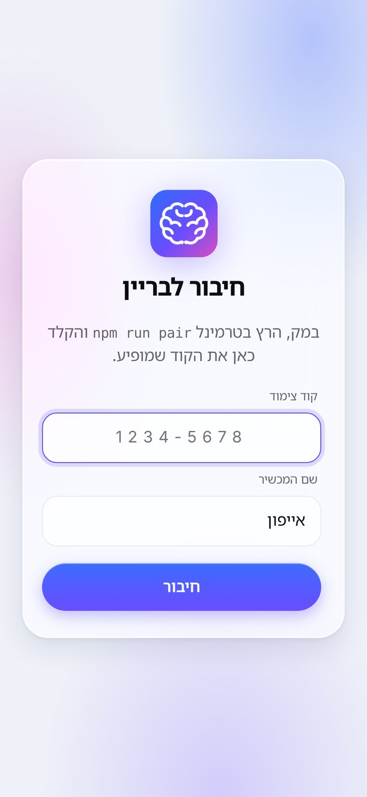 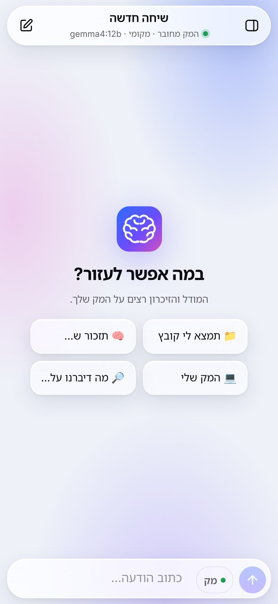</p>

1. באייפון: לפתוח את **Tailscale** ולוודא שהוא מחובר (לאותו חשבון של המק).
2. במק: ליצור קוד צימוד:

   ```bash
   npm run pair
   ```

   הקוד עובד פעם אחת, למשך 10 דקות.
3. באייפון: לפתוח ב־**Safari** את כתובת ה־`https://…ts.net`. להקליד את הקוד ושם למכשיר (למשל "אייפון"), וללחוץ **חיבור**.
4. ב־Safari: שיתוף ← **הוסף למסך הבית** ← הוסף.
5. מעכשיו פותחים את בריין **מהאייקון במסך הבית**, לא מ־Safari. זה חשוב בשביל התראות.

צריך להופיע "במה אפשר לעזור?", ונקודה ירוקה עם "המק מחובר".

**גם במק:** לפתוח בספארי את `http://127.0.0.1:8787`, לצמד עם קוד חדש (`npm run pair`), ואז קובץ ← **הוסף ל־Dock**.

## 4. הפעלת התראות

<p align="center">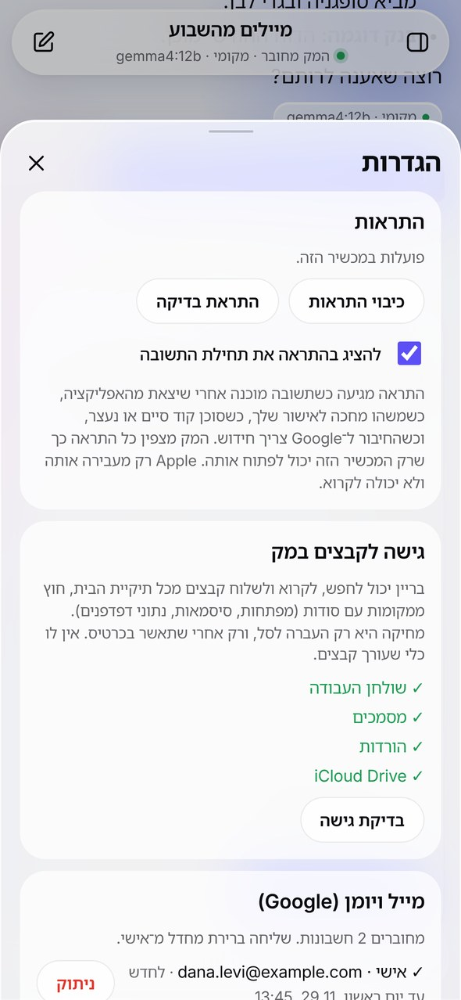</p>

1. באפליקציה שבמסך הבית: תפריט ← **הגדרות** ← **התראות** ← **הפעלת התראות**.
2. iOS מבקש אישור: **אפשר**.
3. ללחוץ **התראת בדיקה**, ולצאת למסך הבית. תוך כמה שניות מגיעה התראה מבריין.

התראה מגיעה כשתשובה מוכנה אחרי שיצאת מהאפליקציה, כשמשהו מחכה לאישור שלך, כש־Claude Code או Codex סיימו או נעצרו,
וכש־Google צריך חידוש. לחיצה על התראה פותחת את השיחה שלה.

לא רוצה שתחילת התשובה תופיע במסך הנעול? לכבות את **להציג בהתראה את תחילת התשובה**.

## 5. חיבור Gmail ויומן Google

Google דורש אפליקציה משלך ב־Google Cloud. היא בחינם, היא רק שלך, ובריין פונה ל־Google ישירות מהמק.

1. להיכנס ל־<https://console.cloud.google.com> עם חשבון ה־Gmail שלך (לאשר את התנאים אם מבקשים).
2. למעלה, ברשימת הפרויקטים ← **New project** ← שם: `בריין` ← **Create**. לוודא שהפרויקט החדש נבחר למעלה.
3. להפעיל שלושה ממשקים. לכל אחד: לכתוב את השם בתיבת החיפוש למעלה, להיכנס וללחוץ **Enable**:
   **Gmail API**, **Google Calendar API**, **People API**.
4. בחיפוש: **Google Auth Platform** ← **Get started**:
   - App name: `בריין`, User support email: המייל שלך ← Next
   - Audience: **External** ← Next
   - Contact information: המייל שלך ← Next ← לסמן הסכמה ← **Create**
5. בתפריט של Google Auth Platform: **Clients** ← **Create client**:
   - Application type: **Desktop app**, Name: `Brain Mac` ← **Create**
   - בחלון שנפתח: **Download JSON**. הקובץ יורד להורדות (שמו מתחיל ב־`client_secret`). לא צריך להעתיק ממנו כלום.
6. בתפריט: **Audience** ← **Test users** ← **Add users** ← כתובת ה־Gmail שלך, וגם של העבודה אם תחבר אותה ← **Save**.
7. במק:

   ```bash
   cd ~/Projects/brain
   npm run google:connect
   ```

   נפתח דפדפן: לבחור את החשבון ← "Google hasn't verified this app" ← **Continue** (או **Advanced** ← **Go to בריין**)
   ← לסמן את **כל** התיבות ← **Continue**. בדפדפן יופיע שהחיבור אושר, ובטרמינל ✔.
8. בדיקה: `npm run doctor` מראה ✔ Google מחובר.

**חשבון נוסף (למשל עבודה):** להריץ שוב `npm run google:connect` ולבחור את החשבון. הטרמינל ישאל איך לקרוא לו.

**כל 7 ימים:** כל עוד האפליקציה ב־Google במצב *Testing*, Google מבטל את ההרשאה אחרי שבוע. בריין מזכיר יום לפני,
במק ובאייפון. מחדשים עם `npm run google:connect`, בלי להפעיל שום דבר מחדש.

## 6. חיבור היומן, התזכורות, אנשי הקשר, הפתקים, ההודעות והמצלמה של Apple

```bash
npm run apple:setup
```

הפקודה בונה אפליקציה קטנה בשם **Brain Helper** (פחות מדקה), כי macOS נותן את ההרשאות האלה לאפליקציות, לא ל־Node.
אם כתוב שחסרים Command Line Tools: להריץ `xcode-select --install`, ואז שוב `npm run apple:setup`.

macOS יציג עד שישה חלונות, אחד אחרי השני. לאשר כל אחד:

- יומן: **אפשר גישה מלאה**
- תזכורות: **אפשר גישה מלאה**
- אנשי קשר: **אפשר**
- מצלמה: **אפשר** (רק בשביל צילום וצפייה במצלמה של המק)
- "Brain Helper רוצה לשלוט ב־Notes": **אישור**
- "Brain Helper רוצה לשלוט ב־Messages": **אישור**

צריכות להופיע שש שורות ✔. מה שבמק מסונכרן לאייפון דרך iCloud, אז אין מה לעשות באייפון.

**אחרי עדכון של בריין** מריצים שוב `npm run apple:setup`: כש־Brain Helper משתנה, macOS מבקש את ההרשאות שלו מחדש.

## 7. הענן והגדרות הפרטיות

<p align="center">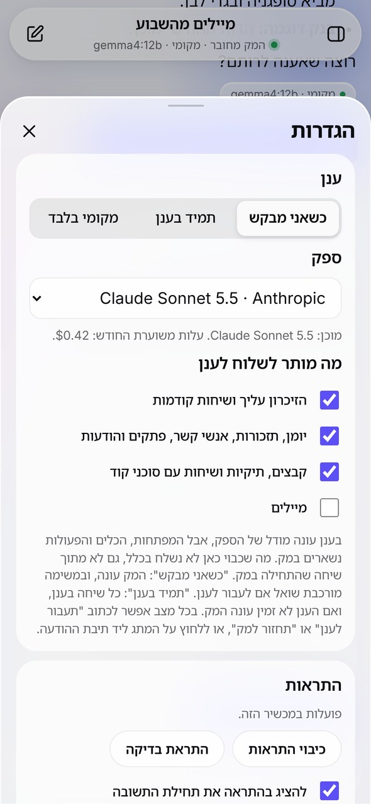 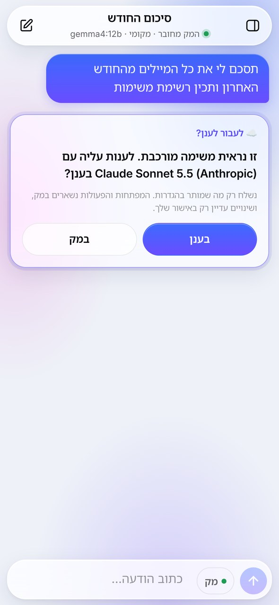</p>

הענן לא חובה. בלעדיו, הכול נשאר במק. איתו, מודל חזק יותר יכול לענות על בקשות ארוכות או מורכבות,
והכלים, האישורים והמפתחות נשארים במק.

**הוספת מפתח** (מ־console.anthropic.com, או platform.openai.com בשביל `openai`):

```bash
npm run cloud:key -- anthropic
```

להדביק את המפתח כשמתבקשים. הוא לא מוצג על המסך, והוא נבדק מול הספק.
אף פעם לא להדביק מפתח בצ'אט, גם לא בזה של בריין.

**בחירת מצב** בהגדרות ← ענן:

- **כשאני מבקש** (מומלץ): המק עונה. בבקשה מורכבת מופיע כרטיס "לעבור לענן?", ועד הבחירה שום דבר לא נשלח.
- **תמיד בענן:** כל שיחה בענן.
- **מקומי בלבד:** שום דבר לא נשלח, אף פעם.

**בחירה מה הענן רשאי לראות**, ב"מה מותר לשלוח לענן": זיכרון ושיחות קודמות; יומן, תזכורות, אנשי קשר, פתקים והודעות;
קבצים וסוכני קוד; מיילים. מה שכבוי לא נשלח בכלל, גם לא מתוך שיחה שהתחילה במק.

בכל שיחה אפשר לכתוב "תעבור לענן" או "תחזור למק", או ללחוץ על המתג **מק / ענן** ליד תיבת ההודעה.
מה בדיוק נשלח: ב[מדיניות הפרטיות](../PRIVACY.he.md).

טיפ: לקבוע תקרת חיוב חודשית אצל הספק. בהגדרות מופיעה העלות המשוערת החודש.

## 8. שימוש בבריין

מדברים עם בריין כמו עם עוזר אישי. כמה דברים לנסות:

<p align="center"></p>

### שאלות קצרות

- **"מה השעה?"** **ו"איזה יום היום?"** נענים מיד, משעון המק.
- כל השאר עובר למודל. במק, ההודעה הראשונה בשיחה חדשה לוקחת כ־10–15 שניות, והבאות כמה שניות. כשהוא עוד קורא, האפליקציה כותבת את זה.
  **לא לשלוח הודעה נוספת בזמן ההמתנה:** הודעה חדשה עוצרת את התשובה שבדרך.

### מייל

<p align="center">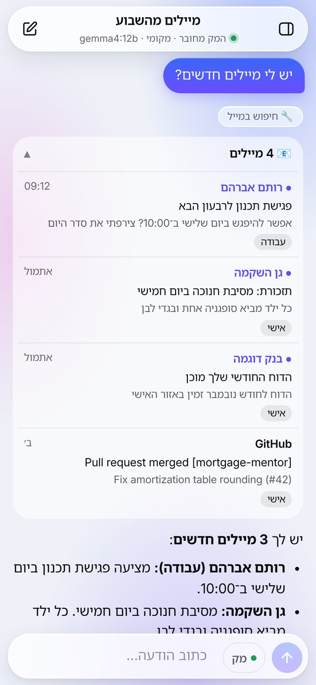 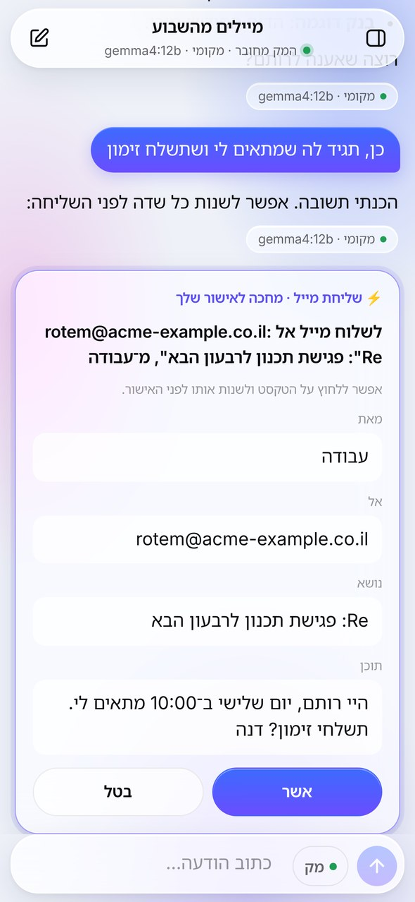</p>

- **"יש לי מיילים חדשים?"** מציג רשימה של המיילים וסיכום קצר.
- **"תענה לרותם שמתאים לי"** מציג כרטיס עם **מאת**, **אל**, **נושא** ו**תוכן**. לחיצה על כל שדה פותחת אותו לעריכה,
  ואז **אשר** או **בטל**. שום דבר לא נשלח לפני האישור.
- **"תוריד לי את החשבונית מהמייל של…"** מביא קובץ מצורף לטלפון, ושם אפשר לפתוח, לשמור או לשתף אותו.
  (יש חברות ששולחות קישור במקום קובץ. אז בריין מראה את הקישור.)

### הודעות

<p align="center">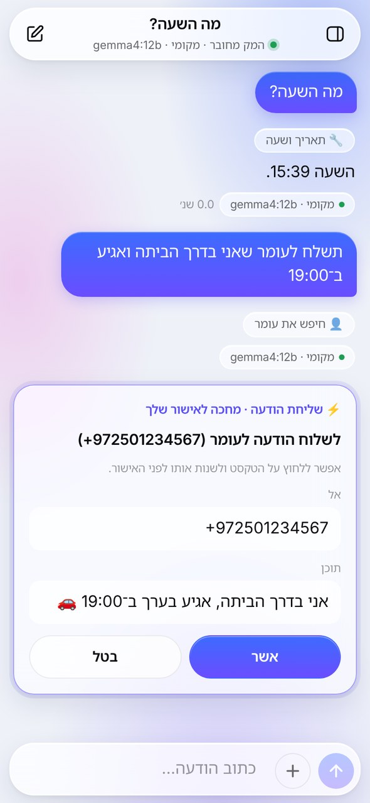</p>

- **"תשלח לעומר שאני בדרך"** מוצא את עומר באנשי הקשר ומציג כרטיס עם המספר והנוסח. **אשר**, והמק שולח iMessage
  (או SMS דרך האייפון). לא צריך לכתוב "הודעה" או "iMessage".
- וואטסאפ עוד לא נתמך.

### יומן ותזכורות

<p align="center">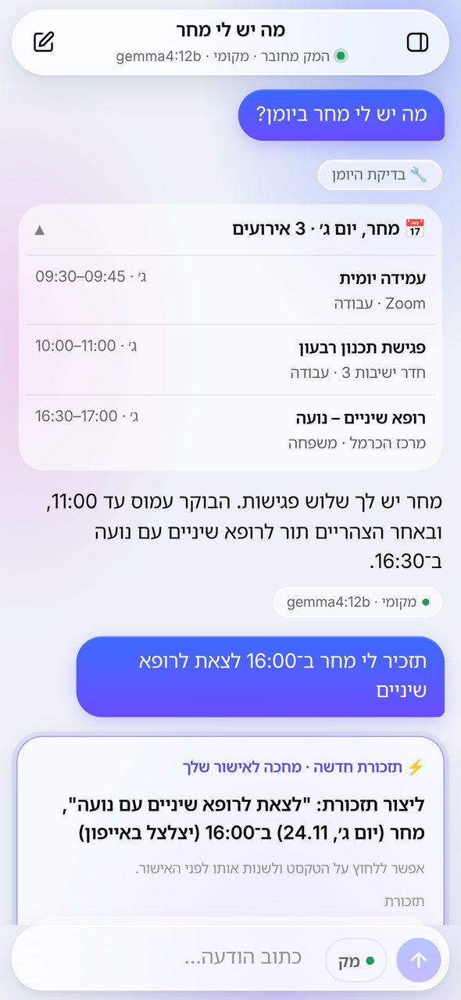</p>

- **"מה יש לי מחר ביומן?"** מציג את האירועים מ־iCloud ומ־Google יחד.
- **"תזכיר לי מחר ב־16:00 לצאת לרופא"** יוצר תזכורת אחרי אישור. היא מצלצלת באייפון.
- **"תקבע לי פגישה ביום שלישי ב־10"** יוצר אירוע אחרי אישור.

### קבצים

- **"מה יש לי על שולחן העבודה?"** מציג את התיקייה.
- **"תשלח לי את קורות החיים"** מוצא את הקובץ ושולח אותו לטלפון. הוא נשאר בשיחה, גם בלי חיבור.
- **"תעביר לסל את…"** מעביר קובץ לסל של המק אחרי אישור. בריין אף פעם לא מוחק קבצים.

### תמונות וקבצים

<p align="center">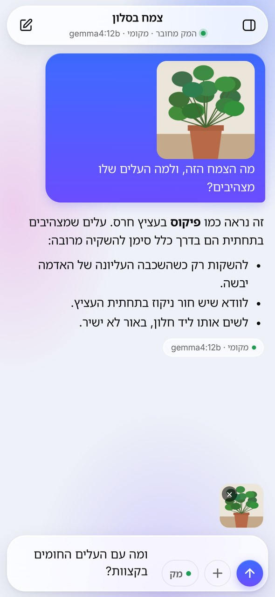</p>

- ללחוץ על **＋** ליד תיבת ההודעה: **ספריית התמונות**, **צילום תמונה** או **בחירת קבצים**. אפשר עד 6.
- כל אחד נשלח למק מיד (בזמן השליחה מופיע "…"). אחר כך כותבים שאלה, או פשוט שולחים.
- **"מה הצמח הזה?"** עם תמונה: המודל במק מסתכל על התמונה עצמה.
- קובץ PDF או Word: בריין קורא את הטקסט שלו במק, ויכול לסכם אותו או לענות עליו.
- לחיצה על תמונה או קובץ בשיחה פותחת אותם שוב, גם בלי חיבור אחרי שנפתחו פעם אחת.

### המצלמה של המק

<p align="center">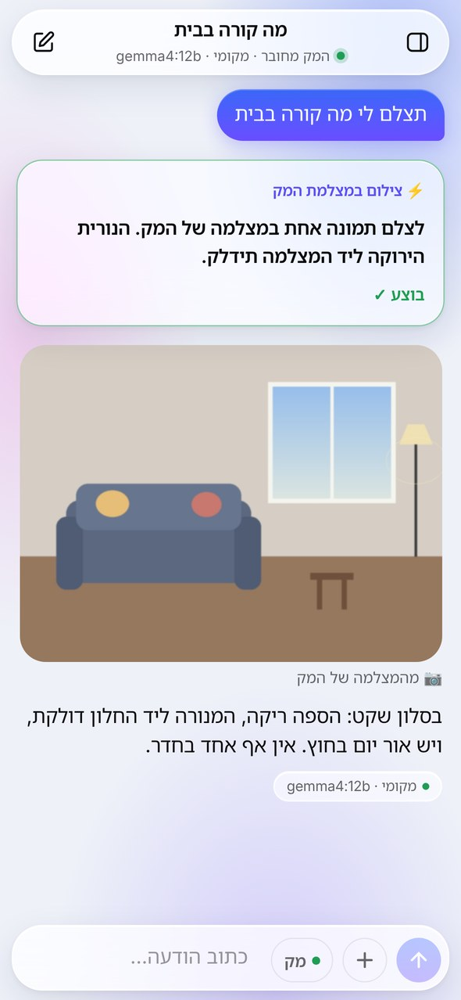 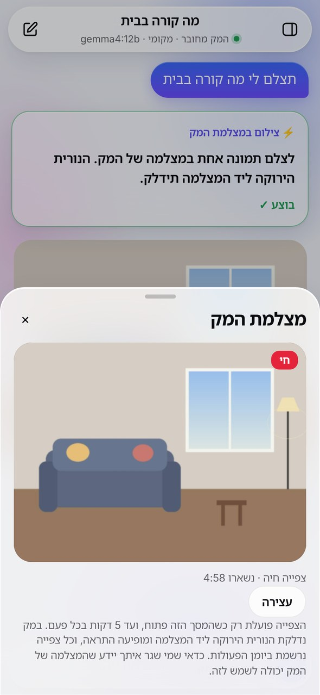</p>

- **"תצלם לי מה קורה בבית"** מציג כרטיס אישור. **אשר**, ומגיעה תמונה אחת עם תיאור. היא נשארת במק ולא נשלחת לענן.
- תפריט ← **מצלמת המק** היא צפייה חיה כל עוד המסך הזה פתוח, עד 5 דקות בכל פעם. **עצירה** מפסיקה אותה.
- הנורית הירוקה ליד המצלמה של המק דולקת בכל שימוש, ובמק מופיעה התראה כשצפייה חיה מתחילה.
  המצלמה עובדת רק כשהמק ער והמכסה פתוח.

### Claude Code ו־Codex

<p align="center">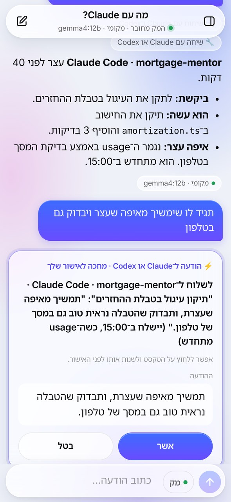</p>

- **"מה עם קלוד? הוא סיים?"** מסכם את השיחה האחרונה: מה ביקשת, מה הוא עשה, ואיפה עצר.
- **"תגיד לו שימשיך"** שולח הודעה לאותה שיחה אחרי אישור. אם נגמר לו ה־usage, ההודעה מחכה לחידוש, ומגיעה התראה.

### ענן

<p align="center">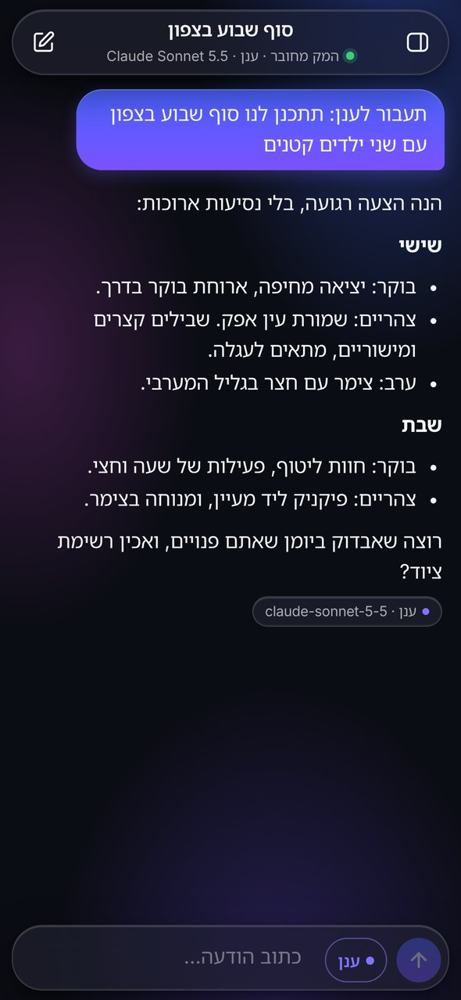</p>

- **"תעבור לענן: תתכנן לנו סוף שבוע בצפון".** ליד כל תשובה כתוב אם היא מהענן או מהמק.

### זיכרון ותפריט

<p align="center">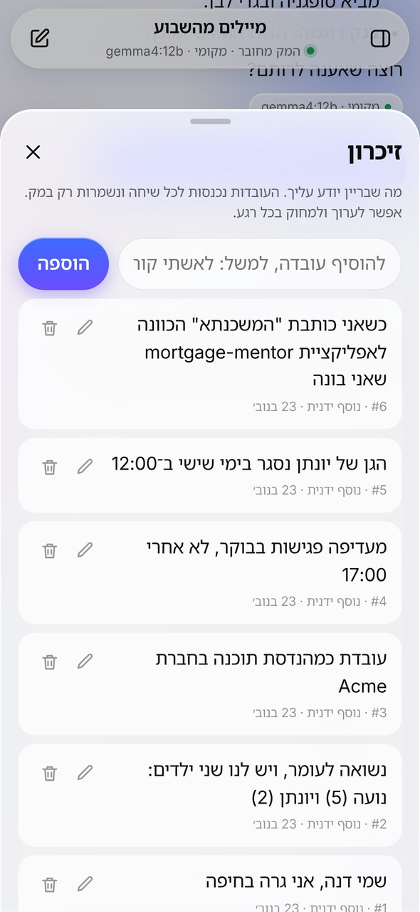 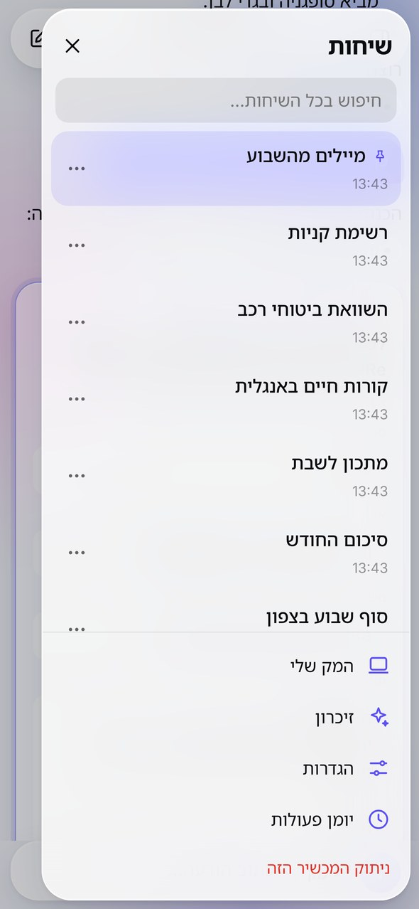</p>

- **"תזכור ש…"** שומר עובדה. כל מה שבריין זוכר נמצא בתפריט ← **זיכרון**, ושם אפשר לערוך ולמחוק.
- **"מה דיברנו על…"** מחפש בשיחות קודמות.
- בתפריט: השיחות (הצמדה, שינוי שם, מחיקה), **המק שלי** (סוללה, אחסון, אפליקציות פתוחות), **הגדרות** ו**יומן פעולות**.

**אפשר לצאת מהאפליקציה.** שואלים משהו ארוך, נועלים את הטלפון, והתשובה מחכה בשיחה, עם התראה כשהיא מוכנה.

## 9. כשמשהו לא עובד

| מה רואים | מה עושים |
| --- | --- |
| "המק לא זמין" | אולי המק ישן, כבוי או מנותק. לבדוק ש־Tailscale מחובר בשני המכשירים. במק: `npm run doctor`. |
| "המק מחובר · Ollama כבוי" | לפתוח את אפליקציית Ollama במק. |
| "קוד צימוד שגוי או שפג תוקפו" | קוד תקף 10 דקות ועובד פעם אחת. להריץ שוב `npm run pair`. אחרי 5 קודים שגויים כל הקודים הפתוחים מבוטלים. |
| אין כפתור **הפעלת התראות** | לפתוח את בריין מהאייקון במסך הבית, לא מ־Safari. צריך iOS 16.4 ומעלה. |
| התראות לא מגיעות | הגדרות ← התראות ← **התראת בדיקה**. לבדוק בהגדרות האייפון ← עדכונים ← בריין. ביומן הפעולות רואים מה שירות ההתראות ענה. |
| תיקייה עם ✗ בהגדרות ← גישה לקבצים | macOS שואל פעם אחת במק ("node רוצה גישה"): לאשר. אם החלון לא הופיע: הגדרות המערכת ← פרטיות ואבטחה ← גישה מלאה לדיסק ← להוסיף את Node (הנתיב המדויק מופיע בהגדרות), ואז `npm run service:install`. |
| "Google לא מחובר", או שהמייל הפסיק לעבוד | ההרשאה השבועית נגמרה: `npm run google:connect`. |
| "המצלמה של המק לא מחוברת לבריין" | במק: `npm run apple:setup`, ולאשר את המצלמה. או: הגדרות המערכת ← פרטיות ואבטחה ← מצלמה ← Brain Helper. |
| "המצלמה של המק לא זמינה" | המק ישן או שהמכסה סגור. גם שיחת וידאו במק יכולה לתפוס אותה. |
| "תמונות HEIC לא נתמכות" | נדיר (האפליקציה ממירה תמונות). באייפון: הגדרות ← מצלמה ← תבניות ← **התאמה מרבית**, או לשלוח צילום מסך. |
| שורה של Apple עם ✘ | כתוב בה איפה מתקנים בהגדרות המערכת. אחר כך שוב `npm run apple:setup`. |
| "המודל במק עדיין קורא את השיחה (… שנ׳)" | רגיל בשיחה חדשה או ארוכה במק. לחכות: הודעה חדשה תתחיל את הקריאה מההתחלה. כדי שיהיה מהר יותר: "תעבור לענן". |
| "המודל המקומי נתקע ולא סיים לענות" | בריין עצר אותו אחרי שתיקה ארוכה. לנסות שוב, לנסח בקצרה, או לכתוב "תעבור לענן". |
| בריין אומר שאין לו גישה להודעות | במק: `npm run apple:setup`, ולאשר "שליטה ב־Messages". אפליקציית ההודעות צריכה להיות מחוברת במק. |
| כל דבר אחר | `npm run doctor`, ו־`npm run service:logs` ליומן השירות. |

אפשר להפעיל את השירות מחדש בכל רגע עם `npm run service:install`. הנתונים ב־`~/.brain` נשארים כמו שהם.

## 10. עדכון בריין

```bash
cd ~/Projects/brain
git pull
npm test
npm run service:install
```

אם ב־[CHANGELOG](../CHANGELOG.md) כתוב כך לגרסה, להריץ גם `npm run apple:setup` ולאשר שוב את החלונות.
השיחות, הזיכרון וההגדרות נשארים כמו שהם. האפליקציה בטלפון עוברת לגרסה החדשה כשפותחים אותה (לפעמים רק בפעם השנייה).
להסרה מלאה: [עדכון והסרה](../README.he.md#עדכון-והסרה).
