# The Brain guide: setup and everyday use

[עברית](GUIDE.he.md) · [README](../README.md) · [Privacy](../PRIVACY.md)

This guide takes you from nothing to talking with Brain on your iPhone, then shows what you can ask it.
Every step says what you should see. Brain's screens are in Hebrew; the screenshots below use made-up data.

**Contents**

1. [Before you start](#1-before-you-start)
2. [Install Brain on the Mac](#2-install-brain-on-the-mac)
3. [Connect your iPhone](#3-connect-your-iphone)
4. [Turn on notifications](#4-turn-on-notifications)
5. [Connect Gmail and Google Calendar](#5-connect-gmail-and-google-calendar)
6. [Connect Apple Calendar, Reminders, Contacts, Notes, Messages and the camera](#6-connect-apple-calendar-reminders-contacts-notes-messages-and-the-camera)
7. [The cloud and your privacy settings](#7-the-cloud-and-your-privacy-settings)
8. [Using Brain](#8-using-brain)
9. [When something doesn't work](#9-when-something-doesnt-work)
10. [Updating Brain](#10-updating-brain)

---

## 1. Before you start

You need:

| What | Why | Where |
| --- | --- | --- |
| A Mac with Apple Silicon, 16 GB of memory or more | Brain and the local model run on it | — |
| Node.js 24 or later | Runs Brain | [nodejs.org](https://nodejs.org), or `brew install node` |
| Ollama | Runs the local model | [ollama.com](https://ollama.com) |
| Tailscale, on the Mac **and** the iPhone, same account | A private, encrypted connection between your devices | [tailscale.com/download](https://tailscale.com/download) and the App Store |
| Command Line Tools | Building Brain Helper for the Apple apps | `xcode-select --install` |
| An iPhone with iOS 16.4 or later | The app, and notifications | — |

Set aside about 15 minutes for the basic setup, plus about 15 minutes for Google and 5 for Apple.

> Check Node's version with `node -v`. It must print `v24` or higher.

## 2. Install Brain on the Mac

Open **Terminal** and run these one at a time.

**Get the code:**

```bash
git clone https://github.com/nissimcoh/brain-assistant.git ~/Projects/brain
cd ~/Projects/brain
```

**Download the local model** (about 8 GB, a few minutes):

```bash
ollama pull gemma4:12b
```

**Run the tests.** They use made-up data and never touch yours:

```bash
npm test
```

You should see `fail 0` at the end.

**Install the background service.** It starts every time you log in and restarts if it crashes:

```bash
npm run service:install
```

**Open it to your own devices** through Tailscale (make sure Tailscale is running and signed in):

```bash
npm run remote:enable
```

It prints an address like `https://your-mac.tail1234.ts.net`. Keep it for the next step. Only devices signed in to
your Tailscale account can open it; nothing is opened to the internet.

**Check that everything is ready:**

```bash
npm run doctor
```

Every line should start with ✔. A ✘ line says exactly what to fix.

## 3. Connect your iPhone

<p align="center">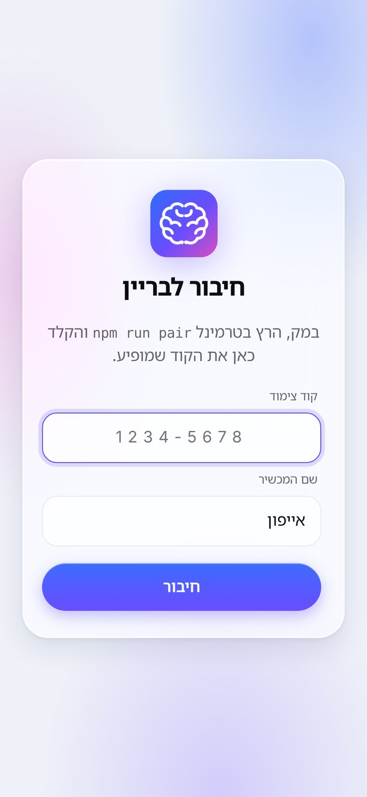 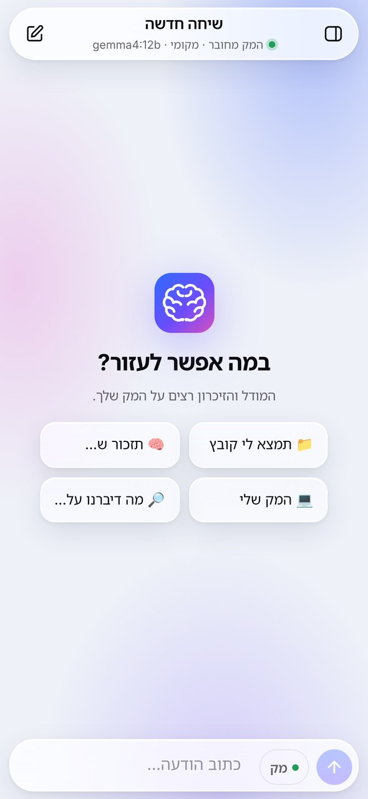</p>

1. On the iPhone, open **Tailscale** and make sure it's connected (the same account as the Mac).
2. On the Mac, create a pairing code:

   ```bash
   npm run pair
   ```

   The code works once, for 10 minutes.
3. On the iPhone, open the `https://…ts.net` address in **Safari**. Type the code and a name for the device
   (for example "iPhone"), then tap **Connect**.
4. In Safari: Share → **Add to Home Screen** → Add.
5. From now on, open Brain from the **Home Screen icon**, not from Safari. This matters for notifications.

You should see "How can I help?" and a green dot with "Mac connected".

**On the Mac as well:** open `http://127.0.0.1:8787` in Safari, pair with a new code (`npm run pair`), then
File → **Add to Dock**.

## 4. Turn on notifications

<p align="center">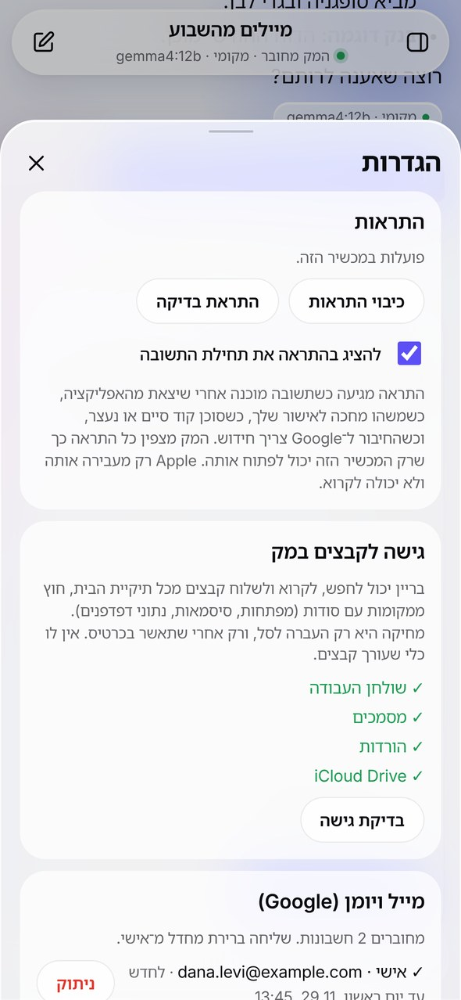</p>

1. In the Home Screen app: menu → **Settings** → **Notifications** → **Turn on notifications**.
2. iOS asks for permission: **Allow**.
3. Tap **Test notification**, and go to the Home Screen. A notification from Brain arrives within a few seconds.

You'll be notified when an answer is ready after you left the app, when something waits for your approval,
when Claude Code or Codex finished or stopped, and when Google needs renewing. Tapping a notification opens its conversation.

Prefer that the lock screen doesn't show the start of the reply? Turn off **Show the start of the reply**.

## 5. Connect Gmail and Google Calendar

Google requires your own app in Google Cloud. It's free, it belongs to you only, and Brain talks to Google directly from your Mac.

1. Go to <https://console.cloud.google.com> with your Gmail account (accept the terms if asked).
2. At the top, in the project list → **New project** → name: `Brain` → **Create**. Make sure the new project is selected at the top.
3. Enable three APIs. For each one, type its name in the search box at the top, open it and click **Enable**:
   **Gmail API**, **Google Calendar API**, **People API**.
4. Search for **Google Auth Platform** → **Get started**:
   - App name: `Brain`, User support email: your email → Next
   - Audience: **External** → Next
   - Contact information: your email → Next → accept → **Create**
5. In Google Auth Platform's menu: **Clients** → **Create client**:
   - Application type: **Desktop app**, Name: `Brain Mac` → **Create**
   - In the window that opens: **Download JSON**. It goes to Downloads (its name starts with `client_secret`). You don't need to copy anything from it.
6. In the menu: **Audience** → **Test users** → **Add users** → your Gmail address, and your work address if you'll connect it → **Save**.
7. On the Mac:

   ```bash
   cd ~/Projects/brain
   npm run google:connect
   ```

   A browser opens: choose the account → "Google hasn't verified this app" → **Continue** (or **Advanced** → **Go to Brain**)
   → tick **all** the boxes → **Continue**. The browser says the connection was approved, and Terminal shows ✔.
8. Check: `npm run doctor` shows ✔ Google connected.

**Another account (for example work):** run `npm run google:connect` again and choose that account. Terminal asks what to call it.

**Every 7 days:** while your Google app is in *Testing*, Google cancels the permission after a week. Brain reminds you a day before,
on the Mac and the phone. Renew with `npm run google:connect`; you don't need to restart anything.

## 6. Connect Apple Calendar, Reminders, Contacts, Notes, Messages and the camera

```bash
npm run apple:setup
```

It builds a small app called **Brain Helper** (under a minute), because macOS gives these permissions to apps, not to Node.
If it says the Command Line Tools are missing, run `xcode-select --install`, then run `npm run apple:setup` again.

macOS shows up to six windows, one after another. Approve each one:

- Calendar: **Allow Full Access**
- Reminders: **Allow Full Access**
- Contacts: **Allow**
- Camera: **Allow** (only needed for photos and live view from the Mac)
- "Brain Helper wants to control Notes": **OK**
- "Brain Helper wants to control Messages": **OK**

You should see six ✔ lines. Whatever is on the Mac syncs with the iPhone through iCloud, so there's nothing to do on the phone.

**After updating Brain**, run `npm run apple:setup` again: when Brain Helper changes, macOS asks for its permissions again.

## 7. The cloud and your privacy settings

<p align="center">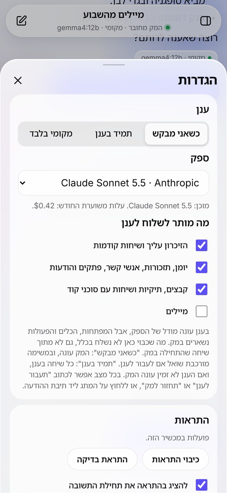 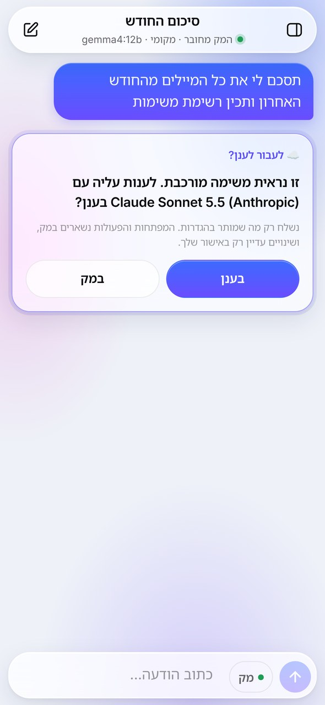</p>

The cloud is optional. Without it, everything stays on the Mac. With it, a stronger model can answer long or complex
requests, while the tools, the approvals and the keys stay on the Mac.

**Add a key** (from console.anthropic.com, or platform.openai.com for `openai`):

```bash
npm run cloud:key -- anthropic
```

Paste the key when asked. It isn't shown on the screen, and it's checked with the provider.
Never paste a key into a chat, including Brain's.

**Choose a mode** in Settings → Cloud:

- **When I ask** (recommended): the Mac answers. For a complex request, Brain shows a "Move to the cloud?" card, and nothing is sent until you choose.
- **Always in the cloud:** every conversation in the cloud.
- **Local only:** nothing is ever sent.

**Choose what the cloud may see** under "What may be sent to the cloud": memory and past conversations; calendar, reminders,
contacts, notes and messages; files and coding agents; mail. Anything that's off is never sent, even from a conversation that started on the Mac.

In a conversation you can always write "תעבור לענן" (move to the cloud) or "תחזור למק" (back to the Mac), or tap
the **Mac / Cloud** switch next to the message box. See the [privacy policy](../PRIVACY.md) for exactly what is sent.

Tip: set a monthly spending limit with the provider. Settings shows this month's estimated cost.

## 8. Using Brain

Talk to Brain the way you'd talk to an assistant, in Hebrew. A few things to try:

<p align="center"></p>

### Quick questions

- "מה השעה?" (what time is it?) and "איזה יום היום?" (what day is it?) are answered at once, from the Mac's clock.
- Anything else goes to the model. On the Mac, the first message of a new conversation takes about 10–15 seconds and the next ones
  a few seconds. While it's still reading, the app says so. **Don't send another message while waiting**: a new message stops the answer that's on its way.

### Mail

<p align="center">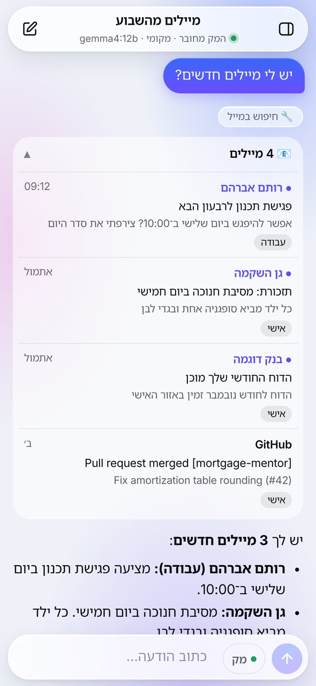 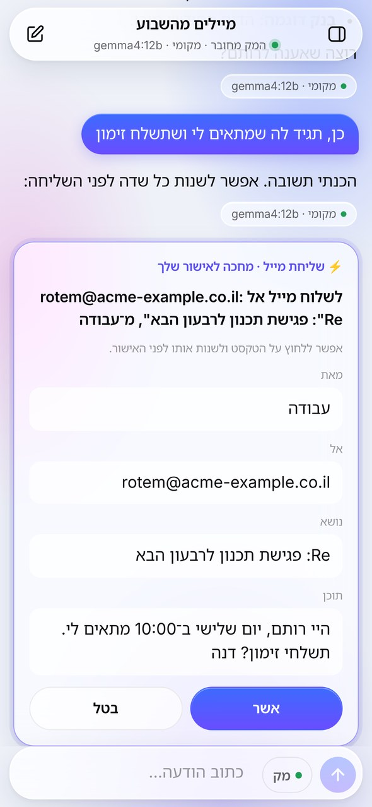</p>

- "יש לי מיילים חדשים?" (any new mail?) shows a list of the mails, and a short summary.
- "תענה לרותם שמתאים לי" (reply to Rotem that it works for me) shows a card with **From**, **To**, **Subject** and **Body**.
  Tap any field to change it, then **Approve** or **Cancel**. Nothing is sent before you approve.
- "תוריד לי את החשבונית מהמייל של…" (download the invoice from …'s mail) brings an attached file to the phone, where you can open, save or share it.
  (Some companies send a link instead of a file; Brain shows you the link.)

### Messages

<p align="center">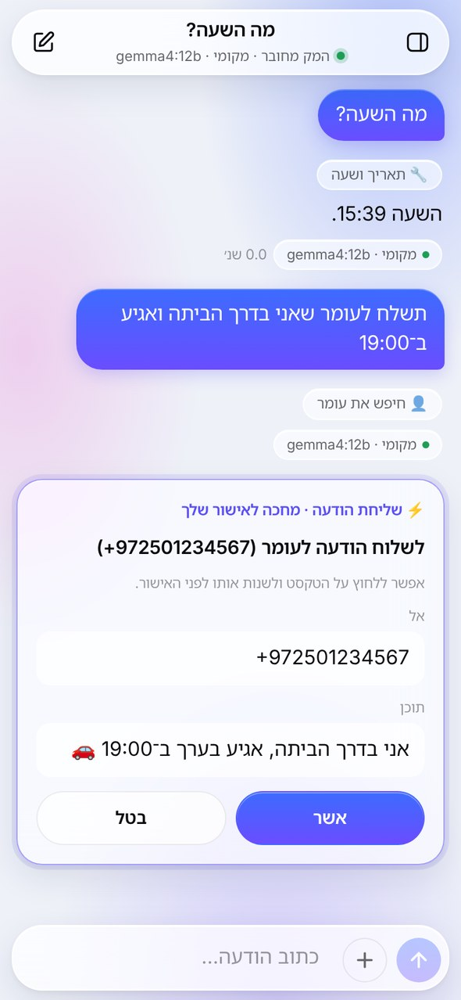</p>

- "תשלח לעומר שאני בדרך" (tell Omer I'm on my way) finds Omer in your contacts and shows a card with his number and the text.
  **Approve**, and the Mac sends it as an iMessage (or an SMS through your iPhone). You don't need to say "message" or "iMessage".
- WhatsApp isn't supported yet.

### Calendar and reminders

<p align="center">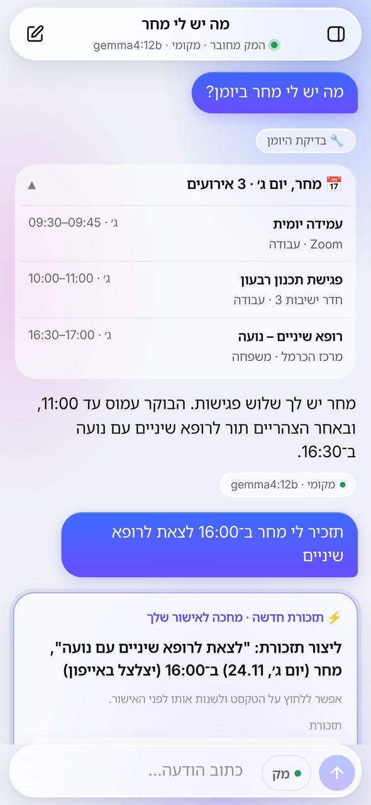</p>

- "מה יש לי מחר ביומן?" (what's on my calendar tomorrow?) shows your events from iCloud and Google together.
- "תזכיר לי מחר ב־16:00 לצאת לרופא" (remind me tomorrow at 16:00…) creates a reminder after you approve. It rings on the iPhone.
- "תקבע לי פגישה ביום שלישי ב־10" (schedule a meeting Tuesday at 10) creates an event after you approve.

### Files

- "מה יש לי על שולחן העבודה?" (what's on my Desktop?) lists the folder.
- "תשלח לי את קורות החיים" (send me my CV) finds the file and sends it to the phone. It stays in the conversation, even offline.
- "תעביר לסל את…" (move … to the Trash) moves a file to the Mac's Trash after you approve. Brain never deletes files.

### Photos and files

<p align="center">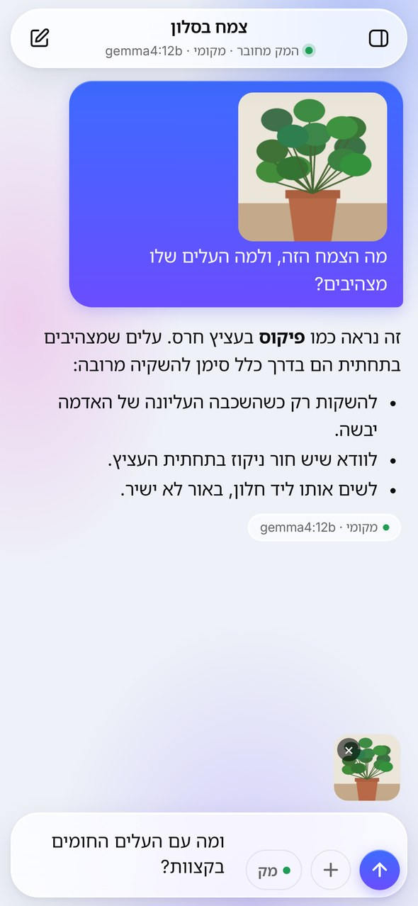</p>

- Tap **+** next to the message box: **Photo Library**, **Take Photo** or **Choose Files**. You can add up to 6.
- Each one goes to the Mac right away (a small "…" while it does). Then write a question, or just send.
- "מה הצמח הזה?" (what plant is this?) with a photo: the model on the Mac looks at the photo itself.
- A PDF or Word file: Brain reads its text on the Mac and can summarize it or answer questions about it.
- Tap a photo or file in the conversation to open it again, even offline once you've opened it.

### The Mac's camera

<p align="center">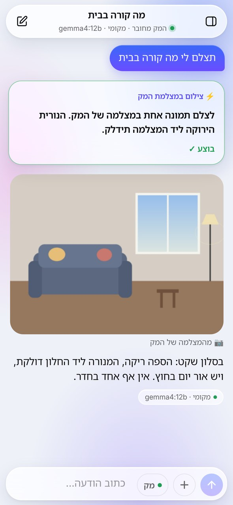 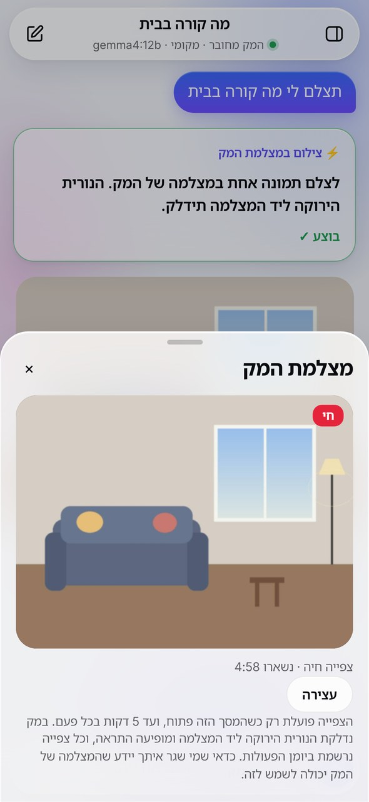</p>

- "תצלם לי מה קורה בבית" (take a photo of what's going on at home) shows an approval card. **Approve**, and one photo arrives,
  with a description. It stays on the Mac and never goes to the cloud.
- Menu → **Mac camera** shows a live view for as long as that screen is open, up to 5 minutes at a time. **Stop** ends it.
- The green light next to the Mac's camera is on whenever it's used, and the Mac shows a notification when a live view starts.
  The camera works only while the Mac is awake with its lid open.

### Claude Code and Codex

<p align="center">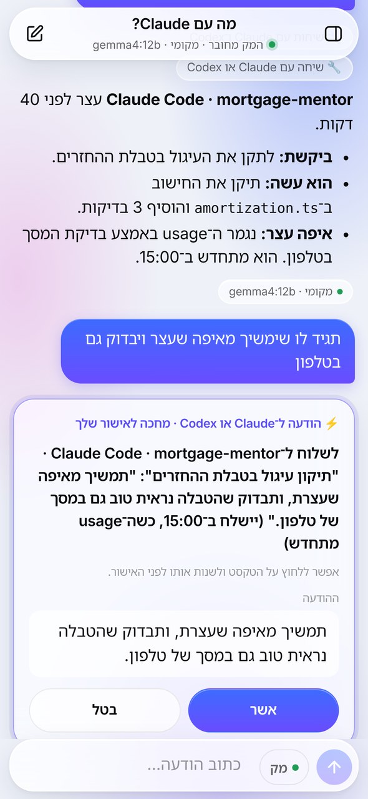</p>

- "מה עם קלוד? הוא סיים?" (what about Claude, did it finish?) summarizes the latest conversation: what you asked, what it did, where it stopped.
- "תגיד לו שימשיך" (tell it to continue) sends a message into the same conversation after you approve.
  If its usage ran out, the message waits for the reset, and you get a notification.

### The cloud

<p align="center">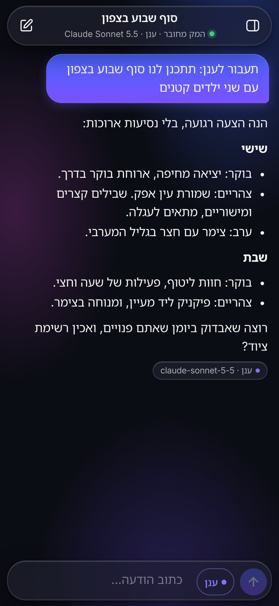</p>

- "תעבור לענן: תתכנן לנו סוף שבוע בצפון" (move to the cloud: plan us a weekend up north). Each answer shows whether it came from the cloud or from the Mac.

### Memory and the menu

<p align="center">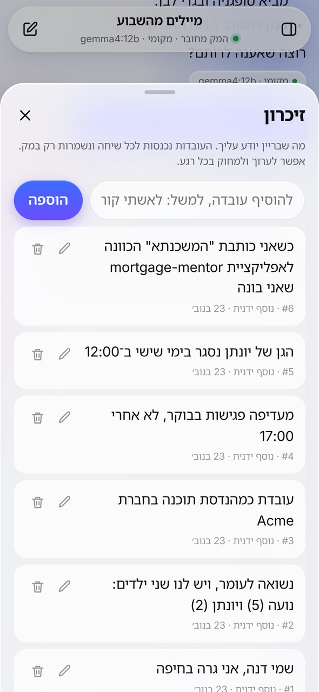 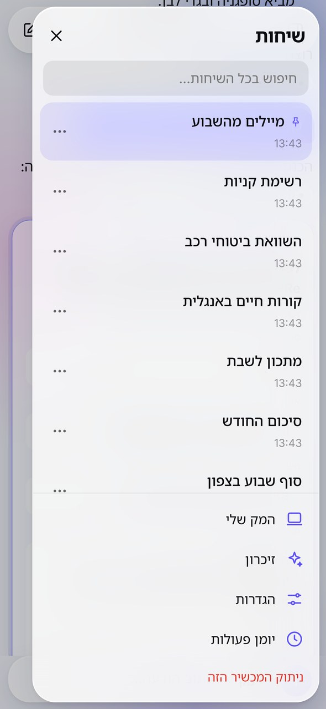</p>

- "תזכור ש…" (remember that…) saves a fact. Everything Brain remembers is in menu → **Memory**, where you can edit or delete it.
- "מה דיברנו על…" (what did we say about…) searches past conversations.
- The menu has your conversations (pin, rename, delete), **My Mac** (battery, storage, open apps), **Settings** and the **Activity log**.

**You can leave the app.** Ask something long, lock the phone, and the answer waits in the conversation, with a notification when it's ready.

## 9. When something doesn't work

| What you see | What to do |
| --- | --- |
| "The Mac is unavailable" | The Mac may be asleep, off or offline. Check that Tailscale is connected on both devices. On the Mac: `npm run doctor`. |
| "Mac connected · Ollama off" | Open the Ollama app on the Mac. |
| "Wrong pairing code or it expired" | Codes last 10 minutes and work once. Run `npm run pair` again. After 5 wrong codes, all open codes are cancelled. |
| No **Turn on notifications** button | Open Brain from the Home Screen icon, not Safari. iOS 16.4 or later is needed. |
| Notifications don't arrive | Settings → Notifications → **Test notification**. Check iPhone Settings → Notifications → Brain. The activity log shows what the push service answered. |
| A folder marked ✗ in Settings → File access | macOS asks once on the Mac ("node wants access"): approve it. If no window appears, add Node under System Settings → Privacy & Security → Full Disk Access (the exact path is shown in Settings), then `npm run service:install`. |
| "Google isn't connected" or mail stopped working | The weekly permission ended: `npm run google:connect`. |
| "The Mac's camera isn't connected" | `npm run apple:setup` on the Mac, and allow the camera. Or System Settings → Privacy & Security → Camera → Brain Helper. |
| "The camera isn't available" | The Mac is asleep or its lid is closed. A video call on the Mac may also be using it. |
| "HEIC photos aren't supported" | Rare (the app converts photos). On the iPhone: Settings → Camera → Formats → **Most Compatible**, or send a screenshot. |
| An Apple line with ✘ | It says where to fix it in System Settings. Then run `npm run apple:setup` again. |
| "The Mac is still reading the conversation (… s)" | Normal for a new or long conversation on the Mac. Wait for it; a new message would start over. For speed, write "תעבור לענן". |
| "The local model got stuck and didn't finish answering" | Brain stopped it after a long silence. Try again, write it shorter, or write "תעבור לענן". |
| Brain says it has no access to messages | `npm run apple:setup` on the Mac, and approve "control Messages". Messages must be signed in on the Mac. |
| Anything else | `npm run doctor`, and `npm run service:logs` for the service log. |

The service can be restarted any time with `npm run service:install`. Your data in `~/.brain` stays as it is.

## 10. Updating Brain

```bash
cd ~/Projects/brain
git pull
npm test
npm run service:install
```

If the [changelog](../CHANGELOG.md) says so for a version, also run `npm run apple:setup` and approve the windows again.
Your conversations, memory and settings stay as they are. The app on the phone picks up the new version when you open it
(sometimes only on the second time). To remove Brain completely, see [Updating and uninstalling](../README.md#updating-and-uninstalling).
